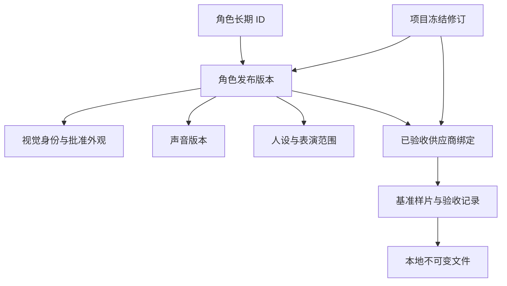
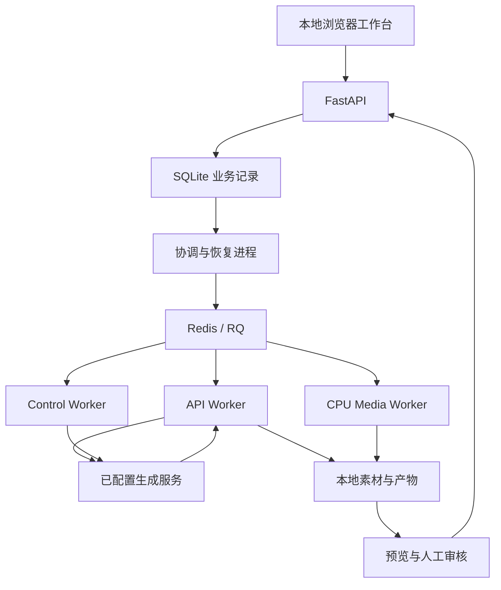
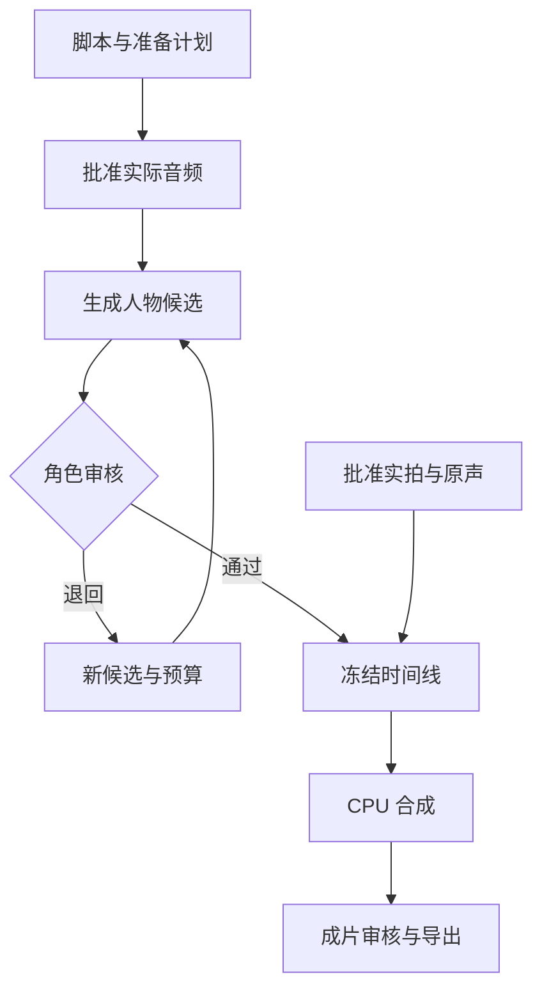
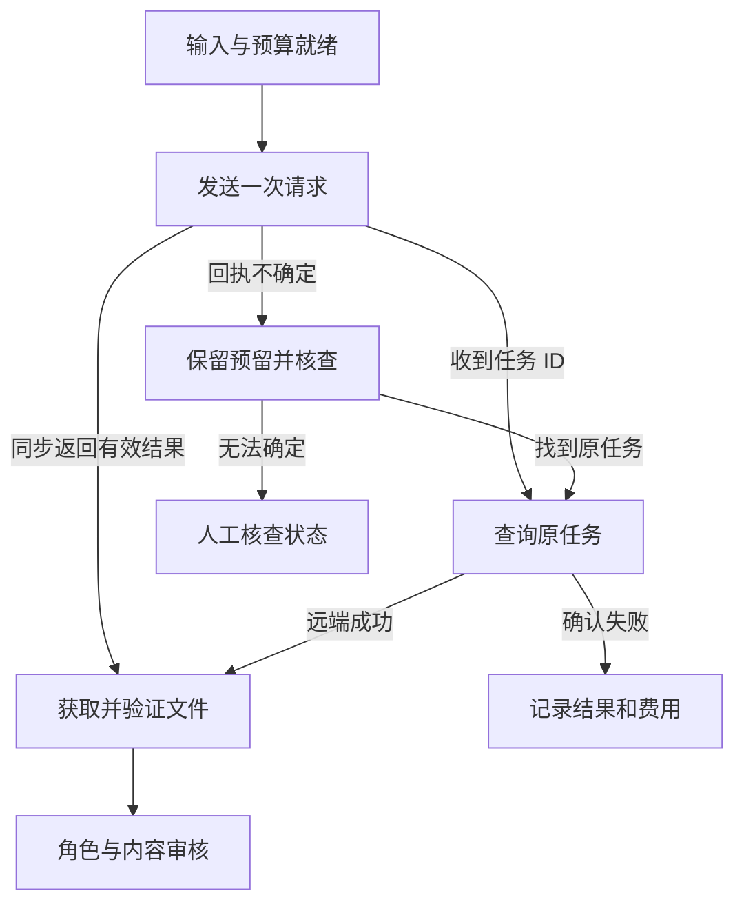

# 数字人 IP 内容引擎：产品规划与技术架构 v1.2

> 核心目标：先建立一个能够持续复用、经过样片验证的稳定数字人 IP，再让它参与教育、产品介绍、娱乐、情感、观点表达等内容生产。采用 FastAPI 本地工作台、可替换的云端生成 API 与本地实拍混剪；当前电脑没有独立 GPU，不作为项目启动障碍。

| 项目 | 定义 |
| --- | --- |
| 文档版本 | 1.2，分阶段实施基线；v1.1 原文归档保留 |
| 编写及资料核实日期 | 初稿 2026-11-18；本次修订 2026-11-19；各资料核实范围见第 28 章 |
| 文档时区 | Asia/Shanghai；系统内部时间使用 UTC |
| 暂定产品名 | 数字人 IP 内容引擎 |
| 英文代号 | Avatar Content Engine |
| 最高优先级 | 人物视觉身份、声音、人格表达及跨视频一致性 |
| 后台 | FastAPI，唯一业务后台 |
| 首版运行环境 | 单用户、本地 CPU、浏览器操作；生成能力优先使用 API |
| 原始素材 | 本地管理；按任务上传生成所必需的文件 |
| 内容类型 | 教育、产品介绍、娱乐、情感、观点、带货、自定义；商品和购买引导可为空 |
| 首个可用版验收对象 | 一个通过有限范围验收的角色、一种主内容结构、一条 30–60 秒完整样片；验证局部修改可复用 |
| 可靠生产版验收对象 | 同一方向连续三条完整作品、跨日角色复测、故障恢复与费用核对；更多内容方向后续验证 |
| 文档状态 | 规划设计，尚未实现应用、购买服务或完成角色实测；不承诺任何服务的实际效果、费用或交付速度 |

**阅读约定：**“必须”表示本项目的实现要求；“建议”表示可调整的产品选择；“官方能力”仅指参考资料明确描述的能力。文中的数量、质量分数、预算规则和流程门槛为本项目的设计目标，不是供应商 SLA 或已经获得的测试结果。配置、ID、哈希与样例素材均为说明性数据。本文档版本与 `ace.*` 数据协议版本独立；未改变结构的示例继续使用协议 1.1，不能仅因文档升版就修改协议号。

本文件是当前开发基线；[v1.1 原文](archive/digital-human-content-engine-architecture-v1.1.md)只作历史对照。当前仓库尚无应用实现，以下目标与待办不表示已经完成。

**实施摘要：**

1. 首个验证场景建议采用“数字人引入 → 用户实拍演示 → 数字人总结”，先选择一个主题方向。具体主题、受众和发布平台待确定，不把第 27 章的吉他示例当作已确认需求。
2. 当前允许先核查 Qwen 免费额度、准备接口测试；实际账号、模型和余额尚未验证。文本、配音、人物视频分别选型，不能互相替代。
3. 先用最小脚本验证资产和 API，再建设最小工作台；首版只启用一个视频服务和一套声音管线。
4. 第一次外部调用就保存输入、提交和费用记录；付费请求回执不确定时禁止自动重发，成功结果立即归档。
5. 完整 outbox、多进程队列、并发预算和批量操作在可靠生产版交付；首个可用版保持单任务运行。
6. 角色质量、每条可用作品成本和人工耗时共同决定是否继续投入。缺少人物视频证据时，可以完成原型，但不能宣布数字人验证通过。

## 目录

1. [版本变化与项目原则](#section-01)
2. [什么才算稳定的数字人 IP](#section-02)
3. [首版范围、能力边界与验收门槛](#section-03)
4. [创建数字人的两条路线](#section-04)
5. [角色资产、版本与发布模型](#section-05)
6. [视觉身份资产包与外观规则](#section-06)
7. [声音、配音与音频主文件](#section-07)
8. [人设、内容主题与表达一致性](#section-08)
9. [稳定性测试、审核与漂移处理](#section-09)
10. [生成服务与模型选型](#section-10)
11. [模型适配器、能力登记与供应商切换](#section-11)
12. [总体架构与技术栈](#section-12)
13. [数据库与核心对象](#section-13)
14. [实拍素材、资料与参考视频](#section-14)
15. [脚本、分镜与时间线协议](#section-15)
16. [生产流程与局部重做](#section-16)
17. [音视频合成与导出规范](#section-17)
18. [异步任务、重试、取消与恢复](#section-18)
19. [素材传输、临时链接与访问边界](#section-19)
20. [预算、成本与生产指标](#section-20)
21. [HTTP API 与事件接口](#section-21)
22. [工作台页面与操作流程](#section-22)
23. [代码结构、配置与无 GPU 部署](#section-23)
24. [备份、升级与 v1.0 迁移](#section-24)
25. [分阶段实施与任务清单](#section-25)
26. [验收场景、风险与决策记录](#section-26)
27. [完整示例：教育视频与角色配置](#section-27)
28. [官方参考资料与版本记录](#section-28)

---

<a id="section-01"></a>
## 01. 版本变化与项目原则

### 1.1 已确认需求

1. 稳定数字人是产品基础。需要反复制作视频后，观众仍然认得是同一个人，声音和人物表达也保持连续。
2. 使用 FastAPI 后台。当前没有独立 GPU，不能把 CUDA、ComfyUI 或本机大模型作为启动依赖。
3. 用户自己的实拍片段是核心素材，允许指定必用区间、保留原声和锁定镜头。
4. 支持多内容方向。商品、价格、营销目标和购买链接不是通用内容项目的必填字段。
5. 可以使用商业模型 API，也保留以后接入本地或自租 GPU 的空间。
6. 可以分析参考视频的结构、节奏和镜头功能；动作驱动是独立的可选能力。
7. 视频以镜头为单位生成、审核和重做，尽量复用已经确认的资产。

### 1.2 v1.0 → v1.1 的历史变化

| 领域 | v1.0 方向 | v1.1 决策 |
| --- | --- | --- |
| 开发起点 | 工作台与本地模型链路 | 先验证角色稳定性，再建设完整工作台 |
| 默认算力 | 本机单 GPU 优先 | 本地 CPU + 云端 API；本地 GPU 为可选适配器 |
| 数字人生成 | 口型模型为主要候选 | 按稳定性、固定音频、账号权限和真实费用选择服务 |
| 角色管理 | 固定角色、声音与参考素材 | 增加身份、外观、声音、人设、表演预设及发布组合的独立版本 |
| 稳定性 | 成片人工检查 | 建立基准样片、准入测试、允许变化范围、漂移停用及回归机制 |
| 模型切换 | 上层协议保持一致 | 上层协议可复用，但新供应商绑定必须重新验收 |
| 任务恢复 | 本地执行与 GPU 资源核查 | 增加外部提交不确定、重复扣费风险、账单核对、临时 URL 恢复 |
| 完全离线 | 默认本地推理 | 保留本地素材与剪辑模式；云端生成需要联网及素材传输 |

### 1.3 产品价值与实施顺序

自研重点是角色资产、内容编排、实拍混剪、质量记录和制作流程。生成模型通过适配器提供能力。

开发顺序固定为：**明确首个内容与试验上限 → 角色样片验证（具备基础提交及费用保护）→ 冻结首个角色发布版本 → 一条视频端到端制作 → 连续作品、故障恢复与完整预算控制 → 内容助手和更多场景。**

不把页面数量、接入模型数量或一次生成成功，作为稳定数字人已经完成的证据。

### 1.4 v1.2 的实施调整

| 调整 | 当前决策 |
| --- | --- |
| 首版交付范围 | 将 P0 拆成 P0-A 最小可用版与 P0-B 可靠生产版，见第 3、25 章 |
| 第一内容场景 | 先验证一种内容结构，连续作品验证后再扩展方向 |
| 免费 API | Qwen 文本、TTS 和人物视频独立核查额度；默认仅使用有可靠费用保护的试用调用 |
| 基础可靠性 | 请求持久化、外部任务 ID、未知提交隔离、自动下载和调用上限提前到首次调用 |
| 可持续性 | 补充跨日复测、人工耗时、现金支出与免费额度耗尽后的成本估算 |
| 实现规模 | P0-A 可用一个独立执行进程；完整队列拓扑与通用任务 DAG 后置 |
| 已知状态 | 账号、主形象、声音、预算和性能均待实测，不写成已选型或已通过 |

### 1.5 当前待确定的产品边界

本轮先按“单用户本地创作工具”规划，不预设为对外 SaaS。首个方向、受众、目标平台与画幅需在阶段 A 记录；优先只选一种结构和一个输出 profile。30–60 秒是首条端到端样片的建议长度，不是产品永久限制。

支持多内容方向仍是中期目标。第一轮先回答“是否愿意长期使用这个人物”“能否稳定完成一条内容”“与现有制作方式相比是否节省时间”。不为验证通用性同时铺开所有内容模板。

<a id="section-02"></a>
## 02. 什么才算稳定的数字人 IP

### 2.1 六个维度

| 维度 | 要保持的内容 | 允许的变化 | 典型失败 |
| --- | --- | --- | --- |
| 视觉身份 | 五官关系、脸型、年龄感、肤色特征、体型和辨识特征 | 经确认的服装、发型、光线和机位 | 换一句台词就像另一个人，脸型随动作变化 |
| 声音身份 | 音色、基本音高特征、口音、发音习惯 | 已批准的语速、强弱、情绪范围 | 时而男声时而女声，或同一角色突然变成另一个音色 |
| 人格与表达 | 角色背景、知识边界、价值取向、称呼、语气习惯 | 针对教育、娱乐等内容调整表达方式 | 人设自相矛盾，虚构经历在不同视频中不断改变 |
| 单镜头连续性 | 口型、面部、牙齿、手部、身体与服装连续 | 合理眨眼、转头、停顿和小动作 | 脸融化、牙齿跳变、手指增减、饰品突然消失 |
| 跨镜头与跨作品 | 同一身份在批准的外观和场景中可辨认 | 已批准的 Look 与场景组合 | 换背景或换衣服后人物身份也变了 |
| 长期可延续性 | 有原始资产、版本、基准样片和历史结果 | 经回归验收的模型升级和角色迭代 | 服务升级后旧角色无法再现，且没有保存历史素材 |

稳定不是逐像素相同。目标是在允许变化范围内维持可辨认、可审核的身份连续性。生成模型无法由本规划保证绝对无漂移。

### 2.2 四类约束

| 类型 | 例子 | 系统行为 |
| --- | --- | --- |
| 身份硬约束 | 视觉身份版本、声音版本、指定角色 | 不满足就退回，不用其他角色替代 |
| 场景硬约束 | 使用某个 Look、保留一段实拍原声、禁止更改口播内容 | 校验及审核必须通过 |
| 表演范围 | 小幅手势、温和表情、稍慢语速 | 参数受控，结果仍需审核 |
| 创作偏好 | 背景氛围、字幕风格、镜头节奏 | 可编辑，不影响身份归属 |

随机种子、提示词、同一张图、同一个 avatar ID 或 LoRA，都只能构成控制手段的一部分，不能单独代替稳定性验收。API 若仅公开模型名称而不公开权重修订号，系统也无法锁死服务商内部实现。

### 2.3 三个不得混淆的成功状态

- **技术成功：**服务返回了文件且能够解码。
- **角色合格：**视觉身份、声音和表演达到该角色的准入标准。
- **内容可发布：**角色合格，同时脚本、实拍、字幕和最终组合已确认。

只有最后一个状态允许进入正式导出。静态角色图片加旁白可以用于开发和备用内容，但不能冒充“写实数字人口播能力已验收”。

<a id="section-03"></a>
## 03. 首版范围、能力边界与验收门槛

### 3.1 首个角色的默认边界

为减少一次验证的变量，首个角色先采用：

- 单人、半身或胸像、正面或轻微侧向、相对固定机位。
- 一种经过确认的主语言、一套声音、一种主要外观。
- 小幅表情和手势，先支持普通讲解、提问和温和情绪表达。
- 一次生成一段短口播，再与用户实拍组合。
- 第一批验证使用约 8–15 秒镜头；这属于测试取值，不是产品永久时长限制。

多人物互动、持续大幅转头、复杂手部展示、走动、舞蹈和跨场景剧情作为独立能力扩展。教育内容可以先用“稳定讲述者 + 实拍演示”完成；娱乐和情感内容也可以使用同一角色在已批准的表演范围内表达。

### 3.2 P0-A / P0-B / P1 / 后续

P0-A 对应第 25 章阶段 A–B，交付单任务、人工审核的最小可用版；P0-B 对应阶段 C，补齐可靠生产能力。后文没有细分的“P0”表示两者的总范围，实际实现以本表及第 25 章为准。

| 阶段 | 功能 | 完成标准 |
| --- | --- | --- |
| P0-A | 一个角色、一种 Look、一套声音与明确绑定 | 不可变快照和批准范围可追溯；组件可先共用 JSON 存储和一张版本表 |
| P0-A | API 小样、固定案例与人工审核 | 有真实输入输出、费用及失败记录；可暂停绑定 |
| P0-A | 一家主视频 API 与音频导入/合成 | 使用同一份确认音频；无免费 TTS 时允许自己的录音 |
| P0-A | 素材导入、手工脚本和镜头卡片 | 必用区间、原声、裁切与锁定有效 |
| P0-A | 本地混剪、字幕、预览和导出 | 一条完整内容；只改字幕或实拍顺序不重调人物 API |
| P0-A | 单任务执行和最小费用保护 | 持久化请求、保存 job ID、隔离未知提交、自动下载、调用上限及基础重启核查 |
| P0-A | 简单局部重做与人工费用记录 | 对一个镜头创建新候选，复用其他产物；保留旧项目修订 |
| P0-B | outbox、完整调度、取消与恢复 | 重投与迟到响应不覆盖当前状态；数据库可重建待执行操作 |
| P0-B | 原子预算预留与对账 | 并发不重复占用余额，重复导入账单不重复记账 |
| P0-B | 完整版本操作、依赖管理和备份恢复 | 连续三条同方向作品、故障演练与恢复验证通过 |
| P1 | 脚本助手、参考视频分析、更多模板 | 不改角色硬约束及实拍锁定；有人工编辑路径 |
| P1 | 第二 Look、场景、供应商及更多内容方向 | 新范围独立测试，不直接继承稳定性结论 |
| P1 | 小批量项目 | G4 通过，并发和预算均有上限 |
| 后续 | 动作迁移、剧情、多语言、多角色、本地 GPU、直播、自动发布 | 按实际需求建立独立测试，不阻塞首版 |

### 3.3 交付门槛

| 门槛 | 交付物 | 未通过时的处理 |
| --- | --- | --- |
| G0 资产与试验范围确认 | 主图、声音、人设、首个内容方向、账号能力和调用/费用上限 | 保持手工准备或本地原型，不提交无费用边界的外部任务 |
| G1 小样可行 | 少量不同台词的合格短样片，确认实际 API 可用 | 调整素材、参数或候选服务；按轮次上限停止 |
| G2 角色有限范围准入 | 固定八例、跨日复测、实际文件和已验收绑定 | 保持试验状态；没有视频生成证据时标记未验证 |
| G3 最小可用闭环 | 一条 30–60 秒完整样片、字幕/实拍修改复用和单镜头重做证据 | 修正编排、合成和操作流程 |
| G4 可持续运行 | 同一方向连续三条作品，成本/人工目标及第 26 章关键故障、备份恢复通过 | 保持单任务、人工审核；不开放批量 |

前期验证可以借助供应商网页和最小调用脚本完成。网页样片通过后，还需要验证同一角色和音频通过 API 的实际结果及账号权限；不能把网页功能直接当作 API 已完成。

三类内容方向的完整样片作为 P1 扩展验收，首版先积累同一方向连续生产的证据。纯原声或静态图加旁白可以验证剪辑流程，但不能替代 G1/G2 的数字人口播样片。

### 3.4 投入与继续条件

第一次外部调用前记录本轮最大请求数、每镜头最大候选数、免费额度保护和允许的现金支出。允许现金支出为 0；尚未确定正数预算时不启用按量付费调用。每轮结束再决定下一轮，不自动续跑。

在阶段 B 用首条作品建立实测基线；阶段 C 前确定以下目标，并用连续三条同方向作品核对。没有填写目标就保留“未判断”，不能宣称生产成本可接受。

| 项目 | 记录或判断规则 |
| --- | --- |
| 单条净生成支出上限 | 按币种填写，含重做；角色建立等一次性成本另外列出 |
| 免费额度耗尽后的预计成本 | 按当前价格、用量和重做比例估算，与本次现金支出分别展示 |
| 单条人工时间上限 | 包含文案、试听、挑选、审核、剪辑与返工；API 等待单独计时 |
| 每镜头候选上限 | 初始建议最多 2 个；调整需进入新的轮次/项目配置 |
| 最低主观质量 | 愿意长期使用该人物；身份、声音和准确说话是硬条件 |
| 停止条件 | 预算或候选数耗尽、严重身份漂移、费用未知、权限/传输条件不满足时停止新提交 |

上限是本项目的试验决策，不是供应商收费保证。小样不合适时可以缩小表演范围、修改角色或换路线，不用继续建设完整工作台来掩盖样片问题。

<a id="section-04"></a>
## 04. 创建数字人的两条路线

### 4.1 路线 A：本人或明确授权的真人分身

输入来自同一个人的照片、声音和必要的参考视频。按服务商的要求完成形象建立及授权流程，保存可持续复用的角色和声音标识。

优点是原始身份有现实参考，多角度和不同表情可以补拍；代价是拍摄质量、声音质量以及服务权限会影响建立结果。用户是否采用本人形象由其选择，架构不强制。

### 4.2 路线 B：原创虚拟 IP

1. 先写角色设定，明确外观、年龄感、性格和内容定位。
2. 制作少量角色候选图，人工选定一个主形象。
3. 以主形象为依据制作必要的正面、轻微侧面和半身素材；逐张检查，不把独立文生图结果自动归为同一人。
4. 选择或设计一个可持续使用的声音，固定版本。
5. 建立供应商角色或图片条件绑定，生成不同台词的小样。
6. 通过测试后，冻结角色发布版本和准入的场景范围。

原创 IP 不要求先训练 LoRA，也不要求每次重新生成整个人物。首版优先复用确认后的主形象；换装和换背景走独立变更流程。

### 4.3 首版选择规则

| 用户的目标 | 建议起点 |
| --- | --- |
| 希望观众认得本人 | 真人分身路线，使用本人素材 |
| 希望人物与本人分离 | 原创虚拟 IP 路线 |
| 希望长期有同一个讲述者 | 优先单人固定外观口播能力 |
| 希望全身表演、舞蹈或剧情 | 先完成稳定身份，再验收动作或剧情能力 |
| 暂时没有角色资产 | 先完成资产筛选，不把批量视频生成作为第一步 |

两条路线可以共存于同一系统，但必须有不同的角色记录。参考别人的叙事结构，不自动赋予使用其脸和声音的资格；需要使用某个人物形象或声音时，在资产上登记实际来源和适用范围。

<a id="section-05"></a>
## 05. 角色资产、版本与发布模型

### 5.1 逻辑结构



图中的连接表示业务关联，不要求所有关系都表现为同一张数据库表中的直接外键。发布版本与供应商绑定分别存储，避免角色定义和供应商训练结果相互覆盖。

### 5.2 对象职责

| 对象 | 保存什么 | 变更方式 |
| --- | --- | --- |
| Character | 长期 IP 标识、名称、当前默认发布指针 | 名称等管理字段可改，保留审计 |
| VisualIdentityVersion | 脸、体型、辨识特征、主参考素材、允许变化范围 | 新版本 |
| LookVersion | 该身份的一种服装、发型、背景或机位组合 | 新版本，引用视觉身份版本 |
| VoiceVersion | 音色来源、参考音频、读音词典、语言、允许参数范围 | 新版本 |
| PersonaVersion | 背景、表达习惯、知识边界和内容立场 | 新版本 |
| PerformanceVersion | 手势、情绪、镜头和语速等可用范围 | 新版本 |
| CharacterRelease | 以上版本的一个经过确认的组合 | 冻结后不改内容，发布新组合 |
| ProviderBindingVersion | 服务商、账号域、角色/外观/声音 ID、模型、能力和参数 | 新绑定版本；验收后才可使用 |
| EvaluationRun | 使用哪些输入、哪些绑定、生成了哪些样片、审核结论 | 保留完整历史 |
| ApprovedArtifact | 已确认的图片、音频或视频文件及哈希 | 不覆盖原文件，生成新产物 |

`CharacterRelease` 保存批准的 Look 列表，不把供应商当成人物身份本身。`ProviderBindingVersion` 引用明确的角色发布和外观版本；其声明内容不可变，`validation_state` 等生命周期字段可以通过审计事件变化。

### 5.3 生命周期

1. 编辑角色草稿，确认身份、声音、人设和第一种 Look。
2. 创建冻结的 `candidate_release`，为测试提供不变化的输入。
3. 建立对应的供应商绑定候选，并冻结其参数。
4. 执行测试，保存结果和审核记录。
5. 通过后将绑定标为 `validated`，将该角色组合标为 `approved`。
6. 用户选择该组合成为新项目默认；旧项目仍引用原来的 release 和 binding。

状态至少包括 `draft`、`frozen_candidate`、`approved`、`suspended`、`archived`。状态变化不意味着允许修改已经冻结的内容。发现问题时暂停新生成；已有文件不自动删除，也不自动重新生成。

### 5.4 变更矩阵

| 改动 | 必须新建 | 已有镜头是否可复用 | 需要验收什么 |
| --- | --- | --- | --- |
| 改本期脚本 | 项目修订、受影响音频/镜头 | 未变镜头可复用 | 新台词、声音、口型 |
| 改字幕颜色 | 渲染配置/项目修订 | 可复用全部人物和配音 | 合成可读性 |
| 换服装或背景 | LookVersion；新增外观必须进入新的发布组合 | 旧外观镜头可继续用于旧项目 | 人脸和体型是否仍是同一身份 |
| 改音色 | VoiceVersion、CharacterRelease、对应绑定 | 旧声音仅保留在旧项目 | 声音身份与口型整体回归 |
| 改脸或明显年龄感 | VisualIdentityVersion、关联 Look 和发布组合 | 不自动混用 | 作为角色新视觉版本完整验收 |
| 调整常用表演范围 | PerformanceVersion、发布组合或绑定 | 已确认旧镜头保留 | 新范围的连续性 |
| 换模型/供应商/账号 | ProviderBindingVersion | 已下载的合格镜头可复用 | 角色、音色、权限和输出协议 |
| 服务商后台升级但名称未变 | 新服务观察快照和回归记录 | 旧文件可复用 | 是否出现漂移；必要时暂停绑定 |

### 5.5 供应商身份映射

新增 Look 不能追加进已经冻结的 CharacterRelease；必须创建包含该外观的新组合。只是在同一发布组合已批准的 Look 之间切换时，创建新项目修订即可。

统一登记 `provider`、`account_scope`、`region`、`external_character_id`、`external_look_id`、`external_voice_id`、`model_id`、`engine_options`、`capability_snapshot_id`。不支持某一项的服务保存 `null` 并说明身份控制方式。

例如 HeyGen 官方用 avatar group 聚合角色身份、用 look 表示外观，生成时的 `avatar_id` 对应 look ID。[R12] 本项目保留自己的 Character ID，不直接用供应商 ID 作为业务主键。

声音合成和人物视频可以分别有自己的绑定：`voice_synthesize` 绑定声音版本和 TTS 资源，Look 可以为空；`avatar_from_audio` 绑定形象/Look 并要求使用指定音频。项目保存所有实际使用的绑定引用，不能只固定视频服务而让 TTS 默默变化。

云服务可能不公开实际权重版本，也可能不允许导出角色模型。保存素材和配置能提高迁移能力，但不能保证在另一家服务上得到完全相同的人物表演。旧作品的精确恢复依靠已经下载的文件。

<a id="section-06"></a>
## 06. 视觉身份资产包与外观规则

### 6.1 首个资产包

先准备下面的小型资产包，不要求一开始制作大量视角或服装：

| 资产 | 首轮建议 | 用途 |
| --- | --- | --- |
| 主形象图 | 1 张确认母版 | 身份比较基准 |
| 常用口播构图 | 1 张半身或胸像 | 首个数字人口播 Look |
| 辅助视角 | 1–2 张确实需要的轻微侧向素材 | 验证转头时仍是同一角色；可后补 |
| 声音参考/确认音频 | 1 套 | 固定音色和发音习惯 |
| 角色文字档案 | 1 份结构化记录 | 人设与视觉规则 |
| 合格视频样片 | 从测试产生 | 供后续对照和回归 |

上述数量为控制前期投入的建议。供应商建立真人分身所需的录像、授权材料及质量要求，按所选服务执行，不用本表替代其建模要求。

### 6.2 身份说明书

以明确的可观察特征描述人物：脸型、眉形、眼睛关系、鼻形、嘴形、肤色、年龄感、头身比例、发色、是否佩戴眼镜等。只记录与识别和制作有关的内容，不把无法从素材判断的特征伪装成事实。

每项分为：

- `identity_locked`：视觉身份的固定特征。
- `look_controlled`：可以在批准外观中变化，例如服装和发型。
- `scene_controlled`：镜头、光线和背景。
- `not_supported_yet`：当前未验收的大幅动作或视角。

同一角色的视觉变化应从母版或已批准参考产生，再人工比较。不能将十张独立文生图简单汇总后声称它们训练出了一个稳定角色。

后续图像编辑适配器可评估 Qwen-Image-Edit 等参考图编辑模型；是否能保持本角色身份仍以确认素材和样片为准。[R23]

### 6.3 文件及处理记录

原始资产只读保存。每个裁切、抠图、降采样或色彩处理产生 `asset_variant`，记录原资产 ID、处理参数、工具版本和 SHA-256。

主图和供应商实际收到的裁切图都需要留存。错误的人脸裁切、过强美颜或人像修复可能改变身份，因此处理后的图必须重新预览。

### 6.4 Look 扩展

新服装、新场景、新机位不能自动继承“已验收”状态。生成后先进行静态对照，再用固定短音频测试。只有通过后才进入角色的可选外观列表。

对初期未通过的复杂侧脸、遮挡和手势，明确标为不支持；脚本助手和分镜模板也不得默认安排这类镜头。通过缩小已承诺的表演范围，提高实际生产稳定性。

<a id="section-07"></a>
## 07. 声音、配音与音频主文件

### 7.1 声音来源

首版支持三种输入：固定服务商音色、自己录制的声音、明确有权使用的克隆声音。虚拟 IP 可以采用预设音色，但预设音色可能被其他使用者共同使用，不能据此宣称声音独占。

`VoiceVersion` 至少保存声音来源、语言与口音、服务商账号及 voice ID、原参考音频、准确参考文本、读音词典版本、允许的情绪与语速范围、确认样音和建立时间。服务商不提供某项参数时如实留空。

声音样音至少包含普通陈述、数字或专名、温和情绪三类；同一句试音还应独立生成或录制一次用于比较。不同服务的同名 `speed` 参数不能直接视为同一种速度。

### 7.2 默认采用“先音频、后人物视频”

1. 按角色声音版本生成或导入音频。
2. 检查音色、内容、术语、停顿和实际时长。
3. 必要的降噪、音量处理、段落裁切完成后，生成不可变音频变体。
4. 用户确认该变体后，把**同一份实际音频**交给数字人服务。
5. 字幕时间、人物口型和最终剪辑以这份音频为基准。

HeyGen 提供上传最终音频驱动数字人的接口；火山 OmniHuman 和万相 s2v 也接受图片与音频输入。[R13]、[R15]、[R17] 因此优先选择能接收固定音频的服务，有利于把声音身份与视频生成解耦。

如果未来接入只能“脚本 + 音色 → 带声音视频”的服务，则使用独立的 `integrated_speech` 模式：先下载结果，审核实际声音和时长，再冻结为候选。不能另外再生成一份停顿不同的 TTS 音频覆盖它，并假装仍然对口型。P0 主路线只实施 `approved_audio` 模式。

### 7.3 音频不变量

- 字幕颜色、封面、实拍镜头替换不触发 TTS 重生成。
- 修改台词、发音词典或明显语速时，需要新的音频变体，并使对应人物镜头失效。
- 禁止为了塞进镜头长度而默认加速配音；必须重新安排镜头，或显式选择并审核变速。
- 供应商返回音轨可能经过转码，字节哈希不同并不等于换了声音。通过听检、转录和时间对齐检查内容及同步。
- 如果发生漏词、加词、声音替换或明显错位，退回该候选；不能用字幕掩盖。
- 若最终混音使用原批准音频，必须先确认返回画面与它确实对齐。

### 7.4 没有 GPU 时的声音安排

| 路线 | 定位 | 边界 |
| --- | --- | --- |
| 固定云端 TTS 音色 | 可作为正式声音候选 | 需验收持续音色、中文读音、费用和服务可用性 |
| 用户自己的录音 | 可直接成为正式音频 | 录音内容和处理结果需确认 |
| Kokoro + sherpa-onnx CPU | 轻量旁白、原型及经确认后的正式音色候选 | 官方有中英文和 CPU 示例；不等于任意声音克隆 |
| Qwen3-TTS CPU | 后续实测选项 | 官方程序有 CPU 设备选项，但速度和内存必须实测 |
| 本地/自租 GPU TTS | 以后需要更多控制时启用 | 不是本机启动条件 |

CPU 路径事实见 [R21]、[R22]。选定正式声音后，不能因 API 超时自动换成 CPU 的另一个音色。

<a id="section-08"></a>
## 08. 人设、内容主题与表达一致性

### 8.1 三层分离

| 层级 | 回答的问题 | 例子 |
| --- | --- | --- |
| 角色与人设 | 这个人是谁，平时怎么表达 | 清楚、平和、愿意解释；不编造个人经历 |
| 内容 Profile | 这类内容如何组织 | 教学先说明目标再演示；娱乐可以采用虚构情节 |
| 本期 Brief | 这一次讲什么、给谁看 | 演示一个操作，表达一个生活观点，介绍一项功能 |

同一个角色可以制作多种内容。调整本期语气，不自动改角色身份；明确改变长期人设时创建新 PersonaVersion。

### 8.2 内容 Profile

预置 `education`、`product_intro`、`entertainment`、`emotional`、`commentary`、`commerce`；它们是可编辑配置，不是限制用户方向的封闭枚举。支持自定义 Profile。

每个 Profile 保存受众、结构建议、语气范围、事实处理、常用镜头、字幕风格和可选 CTA。默认 `cta=none`。商品数组可以为空。

### 8.3 人设档案字段

- 自我介绍与虚拟/真人身份说明。
- 常用称呼、语句长度、口头表达习惯。
- 专长、知识边界和需要引用资料的领域。
- 已确认的背景故事及其版本；虚构故事与真实经历分别记录。
- 可接受的轻松、认真、温和、幽默等表达范围。
- 禁止无依据编造的个人使用经历、测试经历和现场见闻。

这是内容一致性设计，不要求每句话都附事实来源。事实、观点、虚构情节、操作说明和个人表达分别标记，按类型审核。

### 8.4 脚本助手的输入与权限

传入角色发布快照、内容 Profile、Brief、必要资料、实拍摘要及输出 schema。模型只返回可编辑的建议，不直接改角色版本或写数据库。

人物参考图不是内容脚本的唯一依据。文本模型可以写文案，但无法仅凭文案证明生成的人脸稳定；这两类验收分别执行。

<a id="section-09"></a>
## 09. 稳定性测试、审核与漂移处理

### 9.1 分阶段控制验证成本

| 阶段 | 建议规模 | 要回答的问题 |
| --- | --- | --- |
| 静态和声音确认 | 一个主形象、一个 Look、少量试音 | 是否愿意长期使用这个人物和声音 |
| 候选初筛 | 最多两条 API 路线，各一个相同输入的短样片 | 哪条路线值得继续验证 |
| 主路线验证 | 下面的 8 个短候选 | 在批准范围内是否稳定、可复用 |
| 完整作品验证 | 先一条完整样片，再连续三条同方向作品；更多方向在 P1 | 人物与实拍组合是否自然，能否重复完成且成本可接受 |
| 后续回归 | 修改模型、音色、Look 或出现异常时触发 | 原有稳定性是否仍成立 |

不为凑足样片数量无限重做。每轮有预算和最大候选数；预算不足时缩小本轮范围并记录“未验证”，不能把未完成检查写成通过。低分辨率预览通过后，正式输出档位仍需至少一次检查。

初筛样片若与固定案例的输入、绑定和规格完全一致，可计入主路线证据。首条与后续作品尽量复用合格镜头，只为缺失内容新增生成；连续作品仍需有本期的新口播镜头，不能全部复用旧片来证明持续生成能力。

### 9.2 主路线固定测试集

所有测试输入和预期结果先冻结。建议每段约 8–15 秒，具体以选定接口限制和句子自然边界为准。

| 编号 | 内容 | 主要检查 |
| --- | --- | --- |
| B01 | 正面平静陈述 | 基础身份、声音、口型和自然度 |
| B02 | 含数字、术语、名称的说明 | 读音与内容准确性，字幕可对应 |
| B03 | 温和微笑及一次强调 | 情绪变化后仍是同一个人和声音 |
| B04 | 带自然停顿、句首句尾静音 | 静音时嘴部、表情和镜头连续性 |
| B05 | 与 B01 不同主题和句式 | 内容改变不带来身份变化 |
| B06 | 批准范围内的轻微构图或视角变化 | 不越过未验收的大动作范围 |
| B07 | 用 B01 的同一份最终音频再次独立生成 | 重复调用的一致性 |
| B08 | 用 B03 的同一份最终音频再次独立生成 | 情绪条件下的重复一致性 |

B07/B08 必须设置 `reuse_policy=never`，确保真的发生独立生成，不能用缓存命中证明模型稳定。声音自身的重复生成另用试音样本比较，避免只验证视频而漏掉 TTS 漂移。

跨日补测 B09/B10：在首次测试的次日或以后，分别用 B01/B03 的同一份最终音频及同一绑定独立生成，均设置 `reuse_policy=never`。与旧样片并排对照，记录日期、账号、模型别名及能获得的服务快照。两例均通过才完成 G2；不能获得精确内部模型版本时如实记录。B09/B10 是额外预算项，不计入八例的 7/8 目标。

若额度不足，先保留 G1 结论并标记跨日验证未完成；不以免费额度不足为由自动切换付费或另一声音。

### 9.3 审核方法

每段需要完整播放，并与主形象和基准声音并排比较。首帧、中间帧和尾帧的静态截图仅辅助定位，不能代替观看整个片段。

| 项目 | 检查方式 | 初始准入标准 |
| --- | --- | --- |
| 视觉身份 | 母版与候选并排，检查脸、体型、年龄感 | 无明显换人或主要特征漂移 |
| 声音身份 | 与基准样音对听 | 无明显换声、口音突变或声线断层 |
| 台词 | 对照批准文本与实际音频 | 关键术语、数字和含义零误读、漏读或擅自新增 |
| 口型 | 重点检查开头、中间、结尾发音段 | 无明显错位；可测时以约 ±120 ms 为初始复查目标 |
| 连续性 | 检查眨眼、停顿、手势和遮挡处 | 无影响使用的面部、牙齿、手部和服装突变 |
| 人设 | 对照 Persona 和本期 Brief | 自我描述、语气和事实归属无冲突 |
| 技术 | 解码、实际时长、画幅、音轨 | 符合已选 profile，文件完整可本地复用 |
| 可追溯性 | 检查快照、输入哈希与模型绑定 | 能找到实际用过的角色、声音、素材、服务和参数 |

±120 ms 是本项目拟定的复查阈值，不代表对所有语音、画面或模型都足够，也不表示已经测得。无法可靠测量时记录 `not_measured`，并执行人工检查。脸声相似度分数也不是通用质量标准。

### 9.4 样片判定与批量准入

每个候选保存 `pass`、`reject` 或 `needs_review`，并使用结构化问题标签，例如 `face_drift`、`voice_drift`、`lip_sync`、`speech_error`、`hand_artifact`、`timing_error`。

初始建议：8 个主路线测试中至少 7 个首次生成达到可用条件，且不得出现严重身份或音色漂移，并完成 B09/B10 跨日复测后，才考虑批准当前有限范围。未通过的候选绝不用于正式成片。这个小样本只支持局部准入判断，不能据此宣称供应商具有某个稳定成功率。

7/8 仅是路线筛选和首次可用性目标。每一项必需能力仍须有通过证据；失败案例要在预算内补测，或把相应能力移出批准范围。基础身份、声音和准确说话属于必需条件，不能通过删掉这些测试来获得准入。

如果存在明显换脸/换声，即使其他候选很好，也需要调整绑定或范围后再做相关测试。若主要问题是服务网络失败，则分开记录基础设施失败与视觉质量失败，避免混淆原因。

### 9.5 扩展与长期漂移

新增 Look、语种、动作、输出档位或生成模型后，用对应的基准子集复查；新增复杂能力还需要新增测试案例。没有测试过的条件保持未启用。

供应商模型名称可能保持不变而内部升级。发现效果明显变化时：

1. 将当前绑定标为 `suspended`，停止新的批量提交。
2. 保留已完成结果及输入，和历史基准样片比较。
3. 核实服务参数、账号资源和公开变更信息。
4. 生成新的验证记录，必要时建立新绑定版本。
5. 通过后恢复新任务；不自动替换历史作品。

正式使用一段时间后，按真实候选数报告“首次可用数 / 完成候选数 / 提交总数”，同时显示重做费用和人工时间。不用少数精选样片代表全部生产表现。

### 9.6 自动检查的边界

P0 实现媒体可解码、时长、分辨率、音轨、输入引用和原声覆盖检查；ASR 可辅助定位漏字。人脸/声纹 embedding 不作为首版依赖。

以后加入相似度或同步检测时，先用本项目已批准和已拒绝的样片校准；结果只触发复查或排序，不能单独自动批准。所用检测代码、权重和训练素材许可分别记录。

<a id="section-10"></a>
## 10. 生成服务与模型选型

### 10.1 选型目标

优先寻找在用户实际角色、中文台词和批准镜头范围内表现稳定的接口。评价顺序为：**身份和声音 → 台词与口型 → 连续性 → 可控性和可恢复性 → 每条可用结果成本 → 生成速度。**

不按模型名称数量选型，不把网页宣传或单条演示当成正式准入。API 和模型是不同维度：商业闭源模型、托管开源模型、自租 GPU 服务都可以通过 API 暴露。

### 10.2 当前有官方依据的候选

| 候选 | 已核实能力 | 本项目用途 | 接入时必须注意 |
| --- | --- | --- | --- |
| HeyGen Avatar API | 可使用已有角色外观或参考素材，支持指定最终音频；当前文档有 Avatar 6 等引擎 | 稳定讲述者、人物口播的首轮候选 | 实际 Look 支持哪些引擎、账号权限和费用；真人视频直接参考与建立 Digital Twin 是不同路径 |
| 火山 OmniHuman 1.5 | 图片 + 音频，可控制一定表演；参数文档有 720/1080 档位 | 原创图像角色和表演口播候选 | 具体 endpoint、音频时长与正式输出条件逐项登记 |
| 火山 OmniHuman 2.0 | 已有官方接口文档 | 新版本评估候选 | 本规划不因版本更高而直接激活；以实际账号及契约测试为准 |
| 阿里万相 wan2.2-s2v | 图片 + 音频驱动口型、表情和动作 | 短口播候选或对照路线 | 本次北京地域文档要求单段音频严格小于 20 秒，480P/720P；不能套用其他 Wan 接口限制 |
| Wan reference-to-video | 使用角色、场景、视频及声音参考生成视频 | 后续剧情和场景扩展 | 参考声音不等于必须逐字复用的驱动音频；能力需分开建模 |
| 可灵 Motion Control | 角色图片 + 参考视频驱动动作 | 后续动作与表演 | 动作迁移不是指定台词口播，也不是身份稳定的自动证明 |

依据：[R11]–[R19]。这些接口的具体模型 ID、权限和限制可能更新，因此建立带核实日期的能力快照，不在核心业务代码里写死供应商常量。

### 10.3 推荐的实施选择

作为**接口实现基准**，优先研究 HeyGen 的已建角色 + 固定音频路径，因为它明确提供可复用角色/外观管理；这是一项工程便利性判断，不是效果排名。[R11]、[R12]、[R13]

作为**实际生产选择**，先用同一角色资产和同一最终音频，对比最多两条用户可开通且预算可接受的路线。另一条可以选 OmniHuman 或万相 s2v。效果、条件或成本不合适时，可改用另一家成为主服务，上层不需要重写。

P0 只启用一家通过验证的主视频服务和一套声音管线。先允许在官方页面建立角色，再把资源 ID 录入本地并验证；不必从第一天自动化供应商全部角色登记流程。

### 10.4 能力与版本事实的处理

- HeyGen 当前模型 API 支持直接参考素材与音频；写实真人视频直接参考具有特定权限条件，不能等同于普通账户的照片输入或已建立数字分身。[R11]
- 万相 s2v 当前单段小于 20 秒；分段必须按语言停顿处理，再在本地合成。[R17]
- OmniHuman 1.5 的具体参数页与其他概述可能对时长有不同表述。实现以所用 endpoint、账号和小样契约为准，未解决的冲突登记为限制未知，不用一个概述覆盖所有版本。[R15]
- Wan 的 `reference_voice` 是声音参考，不保证使用输入音频的原台词和时序，因此不能冒充 `approved_audio` 口播适配器。[R18]
- 模型别名可固定不等于服务内部权重可固定。记录 `version_pinning` 为 `weights_hash`、`dated_model_id`、`model_alias_only` 或 `unknown`。

### 10.5 本地模型和 ComfyUI 的位置

MuseTalk、Qwen3-TTS、本地图像模型和自租 GPU 可在后续作为新适配器接入。[R26] 当前 P0 不安装 CUDA、不设 GPU 必需检查、不要求下载视频模型权重。

ComfyUI 是可选的工作流运行工具，其 Partner Nodes 也可以调用云端服务。[R20] 若 FastAPI 直接调用一个 API 已足够，就不为这一条调用额外搭一层 ComfyUI。以后需要组合多模型图时，再接入专用 ComfyUIAdapter。[R25]

### 10.6 Qwen 与免费 API 的起步路线

“Qwen 免费 API”不是一个涵盖全部生成能力的通用接口。先确认实际服务平台、地域、model ID、账号权限、额度余量与到期时间，再选择测试步骤。Qwen Chat 网页可用也不表示已获得对应 API 额度。

| 环节 | 适合的接口/输入 | 验证内容 |
| --- | --- | --- |
| 脚本与分镜 | 有可用额度的 Qwen 文本接口 | 人设、内容结构、JSON 校验和手工修改；可选，不阻塞手写脚本 |
| 参考素材理解 | 支持对应模态的 Qwen 视觉接口 | 画面摘要、镜头建议；不能用理解输出代替人物稳定性验收 |
| 配音 | 单独的 Qwen TTS 接口，或自己的录音 | 音色、读音、停顿、实际时长；TTS 额度独立核查 |
| 人物口播 | 万相 s2v 或其他接受最终音频的数字人接口 | 同一主图、同一音频下的人物身份、口型和重复一致性 |
| 本地混剪 | FFmpeg | 实拍原声、字幕、时间线、预览与导出 |

Qwen 文本/视觉接口与语音合成接口的能力边界见 [R31]、[R32]。主线手写脚本保持可用；若文本 API 现成可用，可先用最小脚本手工试验，不为此提前建设完整脚本助手。

**2026-11-19 复核：**百炼新人额度规则将 `wan2.2-s2v` 列入已下架的免费额度模型，价格页也将其当前免费额度标为“无”。曾领取且未到期、未耗尽的旧额度是否可用，以该账号控制台为准。不能按旧搜索摘要中的“100 秒”默认安排免费测试。[R29]、[R30]

先做以下最小试验：核查模型额度 → 准备主图和约 8–10 秒确认音频 → 在有费用边界的条件下独立生成两次 → 保存输入输出并审核 → 再决定是否扩到固定测试集。免费额度只够文本时，可验证内容与本地编排，G1/G2 保持未完成。

免费调用仍保留 provider_job、输入快照、用量和下载记录。没有可靠的供应商“额度用完即停”保护时，仅靠本地余额估计不能保证不收费；`free_only` 模式下阻止该模型的新调用，待明确付费预算或可靠保护后再启用。本次文档整理没有执行任何外部生成调用。

<a id="section-11"></a>
## 11. 模型适配器、能力登记与供应商切换

### 11.1 业务能力拆分

| 能力名称 | 输入 | 输出 | P0 |
| --- | --- | --- | --- |
| character_register | 参考资产、角色说明或外部资源 ID | 供应商映射候选 | 可手工登记 |
| voice_synthesize | 台词、声音绑定、读音与表演参数 | 待确认音频 | 是，或导入录音 |
| avatar_from_audio | 生产用已批准角色/Look、最终音频；评测用冻结候选组合 | 待审核人物镜头 | 是 |
| image_edit_identity | 身份母版、外观变化要求 | 新 Look 候选 | 后续 |
| reference_video_analyze | 参考视频/转录 | 镜头结构和节奏建议 | P1 |
| motion_transfer | 批准角色图、动作参考 | 动作视频候选 | 后续 |
| scene_generate | 场景描述、参考资料 | 背景或补充镜头 | 后续 |
| compose | 已选择镜头、时间线、声音、字幕 | 本地视频产物 | 是 |

### 11.2 统一适配协议

```python
class GenerationProvider:
    def describe_capabilities(self, account_scope): ...
    def validate_request(self, request, capability_snapshot): ...
    def prepare_media(self, asset_refs): ...
    def estimate_usage(self, request, pricing_snapshot): ...
    def submit(self, request, submission_context): ...
    def fetch_status(self, external_job_id): ...
    def reconcile_submission(self, submission_context): ...
    def request_cancel(self, external_job_id): ...
    def fetch_outputs(self, external_job_id): ...
```

这是内部协议示意，不是现成 SDK，也不要求每个供应商支持全部方法。不支持取消或回查时返回明确的 `unsupported`，不能伪造成功。同步 TTS 也建立本地计费任务记录，但可以没有外部 job ID。

### 11.3 能力快照内容

至少记录：

- 服务商、账号域、地域、API 版本、模型/引擎 ID、适配器版本。
- 可接受的身份输入：已建 avatar、图片、视频；是否接受最终音频。
- 格式、尺寸、文件大小、时长上下限及边界是包含还是不包含。
- 输出档位、实际输出维度、音轨行为、可能的水印、输出容器。
- 支持的语言和表演范围，以及本项目实际验证过的子集。
- 上传方式、素材句柄期限、输入 URL 规则、结果保留和任务查询期限。
- 异步/同步模式、轮询间隔、并发限制、幂等支持及有效窗口。
- 取消能力和计费规则；没有核实的字段保存 `unknown`。
- 官方出处、核实时间、契约测试时间和结果。

调用前按用途执行确定性校验：`production` 要求角色组合已批准、绑定已验收；`evaluation` 允许冻结的候选组合和候选绑定，但必须限定测试输入、评测预算和人工审核。两种用途都必须满足输入限制、可合成输出与费用预留。错误应在付费提交前尽量发现。

### 11.4 固定路由与切换

P0 使用明确的绑定选择，不实现自动比价后随意换供应商。限流、超时或预算不足时，等待或返回可处理错误。

同一个 IP 禁止静默替换脸、声音、Look、模型或已批准表演档位。切换必须生成新绑定，并在新项目修订中明确采用；未经验证的备用服务不能接管正在生产的角色镜头。

对不包含角色身份的普通背景素材，可以以后采用独立的备用策略，但应与人物生成路由分开。

<a id="section-12"></a>
## 12. 总体架构与技术栈

### 12.1 服务关系



所有云端连接默认由本机主动发起。首版不要求公网服务器、入站 webhook、GPU 或 ComfyUI。需要按 URL 提供文件的服务，另配置一个最小的素材中转能力，见第 19 章。

上图是 P0-B 的目标拓扑。P0-A 可先采用“FastAPI + SQLite + 本地文件 + 一个独立执行进程”，不要求先启动 Redis 或三个 Worker。浏览器关闭不影响该执行进程；重启后按数据库记录恢复。所有步骤串行，API 不承担长任务。

P0-A 的执行进程从数据库领取显式类型的操作，事务外执行 I/O，使用条件更新持久化状态；远端等待写 `next_poll_at` 后让出执行机会，下载有界，控制指令在操作间优先处理。不开放并行与批量。阶段 A 的最小验证脚本同样需要提交前记录和未知提交隔离，但不要求先实现完整调度器。

外部调用与本地媒体操作在逻辑上分开，避免串行进程长时间合成时错过结果下载窗口；P0-A 有在途云任务时优先轮询与归档，暂不启动长合成。需要并发和独立取消时再启用下表完整拓扑。

### 12.2 可靠生产版进程职责

| 进程 | 职责 | P0-B 初始配置 |
| --- | --- | --- |
| FastAPI / Uvicorn | 页面、业务 API、校验、审核与受管文件访问 | 1 个应用进程 |
| Coordinator | outbox 投递、到期轮询、外部任务核查、下载和取消调度 | 1 个独立进程 |
| RQ API Worker | 一次上传、付费提交或下载操作 | 初始 1 个，按带宽和服务额度调整 |
| RQ Control Worker | 状态查询、提交核查和远端取消等短控制操作 | 1 个，避免被大文件传输占住 |
| RQ Media Worker | ffprobe、转码、裁切、字幕、混音和导出 | 初始并发 1 |
| Redis | 执行队列和短期协调 | 业务历史可从数据库恢复 |
| SQLite | 角色、版本、任务、费用、审核和引用 | 本机文件系统，短事务 |

API Worker 不在一个 RQ job 中阻塞等待整段远端生成。Control Worker 每次查询后保存 `next_poll_at` 并退出，由协调器安排下一次。下载大文件属于有超时和大小上限的受控 I/O 操作，不是重复生成；独立控制队列使用独立消费者，不能只分队列却共用一个被下载占住的 Worker。

FastAPI 的轻量 BackgroundTasks 不承担视频生成和长时间媒体处理；采用独立工作进程。[R01] RQ 提供执行设施，业务状态、幂等和恢复规则由本应用实现。[R05]、[R06]

### 12.3 技术栈

| 层 | 选择 | 理由 |
| --- | --- | --- |
| 应用语言 | Python；实现时选择支持中的版本并锁定依赖 | 统一 API、媒体调用和模型集成 |
| Web | FastAPI + Uvicorn | 结构化请求和本地工作台 |
| 数据校验 | Pydantic v2 | 按类型校验角色、脚本、镜头和任务 |
| 数据访问 | SQLAlchemy 2.x + Alembic | 事务和版本迁移 |
| 数据库 | SQLite WAL | 适合首版单机，避免初期维护数据库服务器 |
| 页面 | Jinja2 + HTMX + 少量 JavaScript | 优先完成角色对照、表单和镜头卡片 |
| 队列 | P0-A 独立串行执行进程；P0-B Redis + RQ | 保留业务任务状态与调度边界，按阶段启用队列 |
| HTTP 客户端 | httpx 或供应商官方 SDK，包装统一超时/重试策略 | 将付费提交与普通读取分开 |
| 视频 | FFmpeg + ffprobe，CPU 软件处理 | 规范化、裁切、音频和合成 |
| 字幕/转录 | faster-whisper CPU INT8，可按设备启用 | 本地转录及辅助核对 |
| 场景切分 | PySceneDetect，P1 | 参考视频和素材的镜头边界 |
| 文件 | 本地受管目录；云端仅保存必要传输对象 | 资产可持续复用 |
| 测试 | pytest + 固定媒体样本 + 供应商契约样片 | 覆盖成本、恢复和素材约束 |

页面、数据库、转录和媒体能力依据见 [R02]、[R03]、[R04]、[R07]–[R10]、[R24]、[R27]。具体包版本在实现时形成锁文件，架构文档不把某个短期版本号伪装成已验证组合。

### 12.4 SQLite 约定

- 开启外键、WAL、合理 busy timeout；每个工作单元使用独立连接/session。
- 不在 HTTP 调用、模型等待、上传或转码期间持有写事务。
- 使用条件更新和 `state_version`，不依赖 SQLite 不具备的行级锁语义。
- 数据库不放共享网络盘给多台机器直接写入。
- 预算校验及预留在同一短事务中原子完成。
- 确有多机写入或持续写竞争时再迁移 PostgreSQL。[R04]

<a id="section-13"></a>
## 13. 数据库与核心对象

### 13.1 存储原则

ID 在实现中统一使用 UUID；文档用可读字符串表示。媒体字节保存在文件系统，数据库保存路径、哈希、元数据和引用。路径使用相对受管存储键，不让项目 JSON 直接指定任意本机文件。

视觉身份、外观、声音、人设和表演预设是独立领域对象。为了减少首版重复代码，可放入一张带 `kind` 与 `schema_version` 的 `component_versions` 表，并用不同 Pydantic schema 验证；不为每个小字段建立一套版本框架。

本章列出 P0 的目标数据模型，不要求 P0-A 一次创建全部表。P0-A 先实现角色/发布/绑定快照、素材与变体、项目修订、产物/审核、runs、provider_jobs，以及持久请求幂等记录。串行步骤、费用上限与人工费用记录可先作为运行的结构化数据。通用 task_steps、task_attempts、依赖表、dispatch_outbox、并发 budget_holds 和完整 usage_ledger 在 P0-B 实现。

P0-A 仍通过数据库唯一键和条件更新阻止重复提交，通过完成清单恢复文件登记；不能因为尚未使用 RQ 就把真实状态只存在内存。后续拆表应迁移这些记录，保留原 ID、文件哈希和历史关系，不重发旧任务。

P0-A 的 provider_job 直接引用 run 和稳定的步骤标识，可暂不建立 attempt 外键；第 13.4 节的 `attempt_id` 是 P0-B 目标字段，不能为了满足未来外键提前引入整套任务框架。迁移时为历史记录补建关联，不改变外部 job ID 与提交状态。

### 13.2 角色与供应商

| 表 | 关键字段与约束 |
| --- | --- |
| characters | id、name、active_release_id、status；默认指针不改变历史项目 |
| component_versions | id、owner_id、kind、version、schema_version、payload_json、content_hash、frozen_at；unique(owner_id, kind, version) |
| character_releases | id、character_id、version、视觉/声音/人设/表演版本引用、批准 Look 集合、content_hash、state；冻结后内容不可改 |
| provider_accounts | id、provider、account_scope、region、credential_ref、enabled、concurrency_limit；不存明文 API key |
| service_specs | id、account_id、capability、model_id、api_version、capabilities_json、pricing_snapshot、checked_at；运行引用不可变快照 |
| provider_binding_versions | id、release_id、look_version_id、service_spec_id、external_refs_json、settings_json、validation_state、evaluation_id |
| evaluation_runs | id、run_id、candidate_release_id、binding_id、suite_version、input_snapshot、review_state、summary_json；run_id 唯一关联 runs，执行状态以 runs 为准 |
| reviews | id、target_type、target_id、decision、issue_tags、notes、reviewer、created_at；审核历史追加保存 |

绑定引用的外观必须在对应发布组合允许范围内；其声音配置也必须对应同一发布组合。实体存在不代表可用于生产，还要检查已批准状态和能力范围。

### 13.3 素材与内容

| 表 | 关键字段与约束 |
| --- | --- |
| assets | id、media_type、source_type、original_storage_key、sha256、rights_json、metadata_json、state |
| asset_variants | id、asset_id、role、storage_key、sha256、processing_spec_hash、metadata_json、time_mapping；原变体不覆盖 |
| asset_links | asset_id、owner_type、owner_id、role、tags；同一素材可被多个项目引用 |
| projects | id、title、draft_json、draft_revision、current_revision_id、status |
| project_revisions | id、project_id、revision、release_id、binding_refs、content_profile_snapshot、brief_snapshot、selected_artifacts、timeline_json、render_profile、content_hash |
| artifacts | id、kind、storage_key、sha256、metadata、provenance、provider_job_id、output_index、review_state、created_at；远端产物来源键 unique(provider_job_id, output_index) |
| selections | project_id、draft_revision、slot_key、artifact_id；最终选择复制进冻结修订 |

P0 可以把 Brief、内容 Profile 和事实引用作为结构化快照保存在项目中；需要跨项目复用后再拆独立资料表。商品数据是可选扩展，不能在项目或镜头表中设置必须有 product_id 的约束。

### 13.4 运行、外部作业和费用

| 表 | 关键字段与约束 |
| --- | --- |
| runs | id、run_kind、project_id、project_revision_id、immutable_input_snapshot、state、cancel_requested_at |
| idempotency_keys | scope、key、request_hash、resource_type、resource_id、created_at；unique(scope, key)，持久关联原业务对象 |
| task_steps | id、run_id、step_key、type、input_hash、current_attempt_id、state、state_version |
| task_dependencies | step_id、depends_on_step_id；校验无环 |
| task_attempts | id、step_id、attempt_no、owner_token、delivery_generation、state、heartbeat_at、error_code |
| dispatch_outbox | id、action、target_id、operation_seq、delivery_generation、owner_token、claim_until、state_version、state、next_at；unique(action, target_id, operation_seq)，重投更新同一操作 |
| provider_jobs | id、attempt_id、service_spec_id、binding_id、request_hash、correlation_token、idempotency_key、submission_state、external_job_id、remote_state、poll_seq、next_poll_at、download_state、state_version |
| remote_asset_handles | id、variant_id、sha256、account_id、handle_kind、external_asset_id/object_key、expires_at、state；身份是文件哈希，不是 URL |
| budget_scopes | id、owner_type、owner_id、currency、limit_amount、policy_version |
| budget_holds | id、provider_job_id、scope_id、reserved_amount、remaining_amount、state；每项收费请求在每个适用预算范围内唯一 |
| usage_ledger | id、provider_job_id、event_key、kind、amount、currency、source、occurred_at；unique(event_key) |
| events | id、aggregate_type、aggregate_id、sequence、event_type、payload、created_at；追加事件用于审计和界面恢复 |

`run_kind=evaluation` 和 `run_kind=prepare` 可以没有最终 ProjectRevision，但必须有输入快照；`run_kind=render` 必须引用冻结修订。评测允许候选角色，生产准备要求已批准角色。这样同时避免角色先验收才能生成验收片，以及必须先知道音频时长才能生成音频的循环。

### 13.5 关键数据不变量

1. 已批准的镜头只能引用实际存在且哈希可校验的文件。
2. 项目运行不读取不断变化的 `active_release_id` 作为隐式输入。
3. 同一次逻辑外部生成使用同一个 provider_job；周期轮询不创建新的付费生成。
4. 一个外部作业可以远端成功而本地下载失败；两种状态分别保留。
5. 已取消任务后到达的结果只能成为未选候选，不能覆盖当前修订。
6. 金额使用 Decimal 或最小货币单位，按币种独立记账。
7. 已被项目、角色或导出清单引用的文件禁止垃圾回收直接删除。

<a id="section-14"></a>
## 14. 实拍素材、资料与参考视频

### 14.1 实拍是一等素材

用户上传视频后，依次完成文件类型检查、ffprobe 探测、原文件登记、缩略图、代理预览和必要标准化。原文件不覆盖。

需要特别处理旋转标记、可变帧率、HDR/SDR、音频采样率、单声道/双声道和缺少音轨。转换后建立明确的原文件到标准化变体的时间映射。

### 14.2 必用片段与锁定

| 控制项 | 含义 |
| --- | --- |
| required | 这段素材必须在最终作品中出现 |
| source_lock | 不得换成另一个素材 |
| trim_lock | 不得改变指定的源区间 |
| timing_lock | 不得改变时间线起点和持续时长 |
| framing_lock | 不得改变裁切、画面位置和缩放 |
| speed_lock | 不得变速 |
| audio_lock | 不得改变已确认原声策略 |

“使用过素材”不等于满足要求。需要同时检查源区间覆盖、最终可见区域及音频覆盖；例如把必用画面放到看不见的图层下，不算完成。

### 14.3 原声模式

- `keep`：保留原声；默认禁止旁白覆盖同一讲话区间。
- `mute`：静音；不能因此自动显示原讲话字幕。
- `mix`：明确安排原声与其他音轨共存，需预览确认。
- `duck`：按已确认规则降低某条音轨，而不是任意把关键原声压到听不见。

例如乐器演示可保留演奏原声，数字人在前后讲解。视频介绍也可以保留实拍操作声。原声是否保留由镜头要求决定，不由内容类型或商品字段决定。

### 14.4 资料与事实

保存资料标题、来源 URL 或文件、采集时间、必要文本快照、适用范围及人工确认。资料是内容输入，不能变成任意工具执行指令。

教育和产品说明中关键事实需要依据；观点、情感表达和虚构娱乐按各自性质处理。产品价格和型号的时效只有在该内容确实使用它们时才需要检查。

### 14.5 参考视频的三种模式

| 模式 | 分析/使用内容 | 输出 | 首版位置 |
| --- | --- | --- | --- |
| 结构参考 | 开头作用、镜头节奏、叙事顺序、信息密度 | 新脚本与分镜建议 | P1 |
| 风格参考 | 字幕排版、构图、转场、声音节奏 | 可编辑模板参数 | P1 |
| 动作参考 | 经允许使用的参考表演 | 指定角色的动作候选 | 后续单独验收 |

参考视频的角色身份、声音、背景音乐和完整台词不自动继承。默认创作新的文案并使用自己的角色和素材；需要复用素材时保存来源和实际使用范围。

PySceneDetect 可提供镜头边界，faster-whisper 可转录并给出时间信息；视觉理解服务可作补充，但其推断需允许用户修改。[R10]、[R24]

<a id="section-15"></a>
## 15. 脚本、分镜与时间线协议

### 15.1 两个计划阶段

**准备计划 PrepPlan：**引用已批准角色、台词、素材候选、预期镜头范围和预算；可以在不知道最终音频时长时创建。每个付费步骤执行前冻结其实际输入快照。

**成片计划 CompositionPlan：**选择已下载且审核通过的音视频候选，按实际时长安排镜头、字幕和音轨，再冻结 ProjectRevision。FFmpeg 只执行这份冻结计划。

语言模型提出的“预计 10 秒”只用于草稿提示。最终时间线不能直接相信估计时长。

### 15.2 基础时间协议

- 输出帧率是有理数 `fps_num/fps_den`；首版默认 30/1。
- 视频时间线使用整数帧，音频使用整数采样；默认音频 48,000 Hz。
- 所有区间采用左闭右开 `[start, end)`。
- 原视频使用标准化变体的帧号，原音频使用明确采样号，禁止混用原始 VFR 时间和规范化帧号。
- 若需要转换，保存规则、映射版本和舍入方式，不靠浮点秒数反复累加。

### 15.3 镜头字段

| 字段 | 用途 |
| --- | --- |
| id / kind | 镜头身份；avatar、real_footage、image_card、screen_recording 等 |
| character_release_id | 使用哪个角色组合；非人物镜头可为空 |
| look_version_id / binding_version_id | 明确外观与实际生成绑定 |
| selected_artifact_id | 使用哪一个已审核候选 |
| source_variant_id / source_range | 实拍或图像的真实来源和区间 |
| start_frame / duration_frames | 确定的时间线位置 |
| audio_mode / audio_refs | 原声、旁白、静音或混合配置 |
| framing / locks | 裁切和不可改变项 |
| subtitle_refs | 对应哪份实际音频及已校对字幕 |
| evidence_refs | 需要时关联内容事实或资料 |

### 15.4 时间线校验

1. 同一视频主轨无意外空洞和重叠；有叠层时明确层级及显示范围。
2. 素材源区间不得越界，必用区间必须覆盖。
3. 保留原声的讲话区间与旁白冲突时返回冲突，不擅自静音。
4. 字幕只能来自实际可听音轨，或者明确标记为独立文字卡片。
5. 输出画幅、裁切、时长和锁定项一致。
6. 无商品、无 CTA 的项目通过相同校验。
7. 最终时长包含尾部画面与音频；不能用 `-shortest` 自动截断未结束的内容。

### 15.5 供应商时长与实际镜头

以句子、停顿、修改边界和最小计费单位决定分段，不硬性规定每一句都单独调用。超过接口时长限制时，先修改准备计划，再生成。

输出短于预期时先检查实际内容。有且只有确认无讲话损失、属于允许的尾部静音/静止范围时，才按显式尾帧策略补齐；否则退回候选。不得通过拉伸整段声音或截掉尾字来强行对齐。

<a id="section-16"></a>
## 16. 生产流程与局部重做

### 16.1 一条视频的完整流程

1. 选择已经批准的 CharacterRelease、Look 和供应商绑定。
2. 填写内容 Brief、Profile、目标时长范围和预算。
3. 导入实拍，标记必用片段、原声与锁定条件。
4. 编辑或辅助生成脚本，形成 PrepPlan。
5. 按段生成或导入配音，试听并批准实际音频。
6. 对需要人物出镜的镜头提交数字人 API；其他镜头不提交人物生成。
7. 下载结果，做技术检查和角色审核；选择候选。
8. 依据实际音视频安排时间线、字幕和图卡。
9. 冻结 ProjectRevision，CPU 合成预览。
10. 审核内容和实拍呈现；必要时局部修改，生成新修订。
11. 导出视频、字幕、封面、项目快照、素材使用清单和生成清单。



退回并不自动无限重试。生成新候选需要明确选择和剩余预算；相同请求的网络恢复与创作重做是两种不同操作。

### 16.2 缓存与复用

生成缓存键包含角色发布、Look、声音/实际音频哈希、供应商绑定、服务快照、语义输入、生成参数和目标规格。临时 URL、签名、RQ job ID 不进入内容缓存键。

复用时检查文件完整、审核通过、适用场景及来源快照。缓存返回的是保存好的具体产物，不意味着供应商再次执行能生成相同字节。

用户明确要求“再做一个候选”或执行独立稳定性测试时绕过生成缓存。候选编号和重复试验记录与内容缓存分别保存。

### 16.3 修改影响范围

| 修改 | 需要重新执行 | 可保留 |
| --- | --- | --- |
| 字幕样式 | 字幕渲染、合成 | 配音、人物、实拍 |
| 换实拍或改变其顺序 | 时间线校验、相关音频安排和合成 | 不受影响的人物镜头 |
| 改一句台词 | 对应声音段、人物镜头、字幕及后续时间线 | 其他已经确认的候选 |
| 人物镜头有手部问题 | 对应镜头新候选与审核 | 已批准音频和其他镜头 |
| 改声音身份 | 受影响的配音和人物镜头、发布版本及绑定验收 | 原始实拍、资料与旧作品 |
| 改输出编码质量 | 合成/编码 | 所有符合源画质要求的生成片段 |
| 换供应商 | 新绑定、测试及新生成 | 已下载的合格旧片段可按项目决定复用 |

重新选择候选生成新的项目修订。旧修订和旧导出只读保存，便于比较和回滚。

<a id="section-17"></a>
## 17. 音视频合成与导出规范

### 17.1 输入标准化

首版建议输出 profile 为竖屏 1080×1920、30 fps、SDR、48 kHz 音频；预览可以使用较低分辨率。这是项目默认值，可根据实际素材和电脑调整，不是模型输出能力保证。

必须记录供应商原始输出规格及本地处理链。将 720P 人物放进 1080P 成片不等于获得原生 1080P 人物细节；放大操作在 manifest 中可见。

FFmpeg 负责转换方向、帧率、画幅、色彩和采样率。帧率转换不得改变讲话时长；裁切前后需要预览，避免切掉脸或实拍中的关键操作。[R07]、[R08]、[R09]

### 17.2 音频总线

按职责分为 `speech`、`source_audio`、`music` 和 `effects`。默认情况下，每个讲话区间只有一个主讲话来源；背景音乐不能遮盖要求保留的演奏或讲解。

最终主音轨显式覆盖完整时间线，允许的静音和尾部余量均写入计划。音量目标、峰值和压低策略作为 render profile 的参数，不把同一个数值强加给所有平台或音乐内容。

若供应商视频自带音频，先检查它与批准音频的内容及时间对齐，再决定保留或替换。不能简单叠加两条相同讲话而产生回声。

### 17.3 字幕

字幕文本以批准台词为基础，并对应最终使用的音频。词级时间可由转录/对齐工具辅助获得，再由用户校对。[R10]

字幕分行、字号、安全区、每屏长度和标点是模板参数。自动字幕不能把误读词“改正确”后掩盖音频错误。静音素材中的原讲话，只有被明确选为独立文字说明时才可出现。

### 17.4 实际输出时长检查

使用 ffprobe 和必要的帧/样本检查获取真实时长。[R08] 某些数字人接口可能返回略短于输入音频的画面，不能仅凭请求时长编排。[R11]

处理顺序：确认实际讲话完整 → 检查音画同步 → 判断是否只缺已允许的尾部静音画面 → 明确补尾帧或退回。补帧要记录起点、帧数与原因。若尾字、动作或语义被截断，应重新取得合格候选。

### 17.5 导出包

| 文件 | 内容 |
| --- | --- |
| final.mp4 | 正式成片 |
| subtitles.srt / .ass | 校对字幕；按 profile 输出 |
| cover.png | 已确认封面 |
| project_snapshot.json | 冻结角色、内容、选中素材和时间线 |
| render_manifest.json | 实际工具版本、参数摘要、规格、文件哈希 |
| generation_manifest.json | 各人物镜头的绑定、模型、音频、请求和外部任务引用 |
| usage_manifest.json | 实拍源区间、画面覆盖、原声使用、变速和裁切记录 |
| review_summary.json | 审核结论与必要问题记录 |

导出默认不包含 API key、带签名的临时 URL、授权录像、完整私人原始素材或供应商账密。用户需要迁移或备份时使用单独的资产包导出。

<a id="section-18"></a>
## 18. 异步任务、重试、取消与恢复

本章是 P0-B 的完整恢复协议；P0-A 先实现第 18.2 节提交记录、第 18.3 节安全重试规则、第 18.5 节基础重启核查和第 18.7 节自动下载归档。最小脚本也要在网络请求前写入输入与提交意图。完整 outbox、队列重建、租约和并发取消在阶段 C 交付。

P0-A 未启用 outbox 时，先在数据库短事务创建运行、幂等记录和 provider_job，再由单执行进程条件认领。已持久化 `sending` 而缺少明确回执的任务，在进程恢复时进入 `submission_unknown`，不能被当作普通 pending 再发。无外部作业查询能力时，允许人工核查并保持阻塞。

### 18.1 状态必须分开

| 维度 | 示例状态 |
| --- | --- |
| 本地执行 | pending、preparing、waiting_remote、reconciling、downloading、review_pending、succeeded、failed、blocked |
| 提交 | not_sent、sending、acknowledged、submission_unknown、rejected |
| 远端作业 | unknown、queued、running、succeeded、failed、cancelled |
| 文件 | absent、downloading、persisted、invalid、expired |
| 审核 | not_reviewed、pass、reject、needs_review |
| 费用 | reserved、estimated、confirmed、unresolved、refunded_partial/full |

供应商返回 `done` 或 HTTP 200，不必然等于生成成功。适配器需要检查该接口的错误码、任务状态和输出字段，例如火山接口需要结合外层 code/message 判断。[R15]

### 18.2 外部生成提交协议

试用额度调用沿用相同的提交记录与防重复规则。下列完整事务对象适用于 P0-B；P0-A 使用本章开头说明的简化事务。

1. 本地验证输入、角色绑定、服务能力及预算；按 evaluation / production 使用对应准入规则。
2. 在短事务中建立 attempt、provider_job、预算预留和 outbox；生成持久 correlation token。
3. Worker 条件认领本次短操作，把提交状态持久化为 `sending`。
4. 发起一次付费 HTTP 请求。只有确认响应后才记录 `external_job_id` 与 `acknowledged`。
5. 已发送后发生网络超时、连接断开或进程死亡，转为 `submission_unknown`，保留预算预留。
6. 恢复器核查原任务，不能直接新建一次付费生成。

同步 TTS 等接口成功时可能直接返回音频字节或文件地址，没有 external_job_id。适配器将其标为已确认返回，直接进入保存/下载、校验和费用记录，不进入轮询。同步请求在响应丢失时仍可能已计费，同样保留提交不确定状态；不能凭“没有任务 ID”判断可以免费重发。



### 18.3 本地幂等与远端幂等

本地请求的 `Idempotency-Key`、SQL 唯一键和 RQ job ID 只帮助本系统识别重复操作。它们不自动阻止供应商重复受理和扣费。

只有服务商明确支持“同一 key、同一 payload、在有效窗口内对应同一计费任务”，才允许安全重放。普通 `client_id` 或 tag 只是关联标识，不能当作幂等保证。

SDK/HTTP 客户端对付费 POST 的自动重试默认关闭，除非该适配器已经证明可以安全重放。5xx 也可能发生在受理之后，不能统一当作“尚未提交”。

如果原幂等键绑定的请求包含已过期签名 URL，不得更换 URL 后继续声称是完全相同的 payload。先按供应商契约核查原请求，再决定是否建立新请求。

回查不到原任务时，界面提供继续核查、登记明确的外部任务 ID、或在说明可能重复计费后新建候选等动作。新生成是新的预算动作，不能伪装成无费用恢复。

### 18.4 outbox 与短操作

逻辑操作唯一键为 `action + target_id + operation_seq`，不包含 `delivery_generation`。崩溃后的重投更新同一条操作的 `delivery_generation` 与 owner token，不创建新的逻辑提交。队列投递 ID 可以包含 generation，用来隔离旧消息；下一次正常周期查询才增加 `poll_seq/operation_seq`。

这能避免两个相反错误：重复投递导致再次提交收费请求；过度去重导致一项远端作业只查询一次。

Worker 使用 owner token、当前 attempt 和状态版本进行条件提交。旧 Worker、旧查询或迟到的 `running` 响应不能覆盖已确认终态。Redis 丢失时从数据库重建必要操作，不能把所有旧任务重新执行一遍。

协调器在短事务中检查到期且无同轮待处理操作的 job，推进 `poll_seq` 并创建对应 outbox。操作认领记录 owner、lease 和 generation；崩溃恢复重投同一 operation_seq，下一次正常周期才增加序号。写入查询结果和下一次时间时校验 job 状态版本，避免重复安排或过时状态倒退。

### 18.5 轮询

本机默认轮询，按服务商限制设置间隔和有界退避，尊重 `Retry-After`。关闭浏览器不停止后台；电脑睡眠、关机或网络断开则会中断主动查询。

启动恢复优先检查已知外部任务和即将过期的输出。没有任务 ID 的收费提交先进入核查，不盲目再次 POST。将来增加 webhook 时仍按同一 provider_job 幂等归并，不能多记产物或费用。

### 18.6 取消

- 先记录 `cancel_requested_at`，停止安排未开始的后续步骤。
- 按供应商能力请求取消；`cancel_requested` 与 `cancelled` 分开。
- 不支持远端取消时，清楚显示本地后续已停止、远端仍可能运行。
- 取消不自动等于退款，预算和账单独立核对。
- 完成与取消同时发生时，产物可以作为未选候选保存，但不能被自动选入当前项目。
- 取消控制使用独立短操作通道，不能排在长时间媒体合成后面才执行。

取消只停止新的生产依赖步骤，必要的原任务轮询、提交核查和费用对账继续执行。按配置可保存已付费产生的结果为未选候选；“停止后续生成”不能把账单和远端状态永久留在未知。

### 18.7 下载及文件提交

远端成功后立即下载到临时目录，检查大小、媒体可解码性和实际规格，并计算哈希。完成清单包含 provider_job_id、attempt_id、output_index、input_hash、文件哈希和实际媒体规格。

将媒体与完成清单放在同一输出目录，全部写入并确认后，在同一文件系统内原子重命名该目录，再用短事务登记 artifact、更新下载状态和写事件。数据库登记前崩溃时，根据完成清单及哈希幂等补登记；不能只凭目录里出现 MP4 就认定成功。远端来源唯一键防止下载重试、恢复和未来 webhook 重复登记。

正式选择/发布还要检查当前项目修订和取消状态。恢复的旧结果可以归档为未选候选，但不会越过当前审核覆盖用户选择。

下载失败优先重试下载；URL 过期优先通过原 job 获取新地址。只有确认无法找回并且用户选择新候选后，才重新付费生成。

不同服务的任务和输出保留窗口不同。万相 s2v 文档有 24 小时查询/结果窗口，OmniHuman 1.5 当前结果链接有效期为 1 小时。[R17]、[R15] 因此首版需要在生成期间保持后台运行，完成后自动本地归档；不依赖用户第二天手动点击下载。

### 18.8 重试分类

| 情况 | 默认处理 |
| --- | --- |
| 本地输入校验失败 | 修改输入，不提交收费请求 |
| 已知任务 ID，查询超时 | 有界重试查询 |
| 已知输出，下载暂时失败 | 有界重试下载 |
| 付费提交回执不确定 | 保留预算，核查原任务 |
| 服务明确拒绝且确认未受理 | 修正条件后按契约重试 |
| 远端确认失败 | 记录费用状态，新候选重新估算 |
| 角色审核不通过 | 用户选择修正与新候选，受预算限制 |
| 输出过期且无法恢复 | 标记 artifact_missing，不自动再收费 |

不承诺跨外部服务的 exactly-once。目标是在可观察范围内减少重复执行，并在不确定状态下保守处理。

<a id="section-19"></a>
## 19. 素材传输、临时链接与访问边界

### 19.1 本地文件如何交给云端

供应商不能访问本机 `/data/audio.wav`、Windows 路径、`localhost` 或普通局域网 URL。按实际接口选择：

1. 优先使用供应商上传接口，取得 asset ID。
2. 仅支持 URL 时，将本次所需变体放到供应商允许的中转存储，提供能被其服务直接获取的 HTTPS 地址。
3. 可以使用私有对象和有期限的签名 URL，无须公开整个素材库。
4. 提交前校验格式、大小、可获取性及有效期。

例如 HeyGen 支持已上传音频资产，万相 s2v 使用可访问的图片/音频 URL。[R13]、[R17] 两者用不同的 MediaTransport 实现，上层仍引用同一个受管资产。

### 19.2 传输范围

只上传当前生成步骤实际需要的角色参考图、最终配音或授权参考视频。实拍若仅用于本地拼接，不需要上传给数字人服务。

每项上传保存 `asset_variant_id + sha256 + provider_account + remote_handle + expires_at`。用户可从项目看到本次哪些素材进入哪个服务。云端生成是显式配置的能力，离线模式不会自动联网降级。

### 19.3 有效期管理

输入地址有效期需要覆盖预计排队、处理、服务端延迟取文件和恢复缓冲。提交前不足则先刷新句柄，再冻结实际提交内容。

提交后不能仅改本地数据库里的 URL 就假设远端也改变了输入。若原任务使用的 URL 失效，按供应商契约核查；不能为了换链接自动重新发一个收费任务。

文件内容缓存键排除临时签名；实际 wire payload 的必要记录受保护保存，普通日志及导出中删去签名和密钥。共享远端素材只有在所有相关任务不再需要它后才清理。

### 19.4 本地访问与执行边界

- 默认绑定 loopback，Redis 不暴露到公网；配置密钥保存在受保护环境或本机秘密存储。
- 页面写操作具有会话和 CSRF 保护；需要局域网访问时启用认证及传输保护。
- 输入文件限制类型、大小和解码资源；服务端仅解析受管 asset ID。
- FFmpeg 和其他 CLI 使用参数数组及受控路径，不把脚本文字拼进 shell。
- 远程下载限制协议、目标、重定向和大小，防止项目输入被当作任意内网读取地址。
- 资料和参考视频中的指令只作为内容，不拥有修改系统配置、读取密钥或调用任意工具的权限。

### 19.5 保留与删除

本地原始资产、确认音频、合格镜头和历史导出按引用关系保留；远端上传、任务和结果按服务能力分别清理。

删除本地角色不等于服务商删除了角色、训练素材、声音和生成视频；这些外部资源可能有独立生命周期。需要清理时展示具体资源和结果，不用一个“删除成功”掩盖部分失败。[R12]

<a id="section-20"></a>
## 20. 预算、成本与生产指标

### 20.1 预算范围

支持单次候选、一次评测、一个项目以及账户总体预算。可以只先实现项目与评测两级；账户预付额度作为额外控制，不替代本地记录。

每个范围独立按币种记账。不同币种不直接相减；首版可手工配置展示汇率，但不能把估算转换当作供应商结算金额。

### 20.2 提交前预留

计算方式：

`可用预算 = 设定额度 − 已确认净费用 − 尚未解决的预留`

费用估计由价格快照、时长/字符/次数、输出档位、最低计费单位和取整规则决定。角色建立、声音创建、试音、视频生成和创作重做分别计入。

在建立 provider_job 的同一短事务内，原子检查并预留所有适用预算。多个并发任务不能各自读到同一余额后重复占用。

预算预留在结算后仍保留 provider_job 与 scope 的归属关系。每个 scope 汇总其关联的不同 provider_job 的账务事件；真实总支出只从 usage_ledger 计算一次，不能把项目层和账户层的统计相加而重复计费。event_key 带供应商、账号域和原始事件标识命名空间。

### 20.3 不确定费用与对账

- 提交不确定时保留预留，不显示“实际费用为 0”。
- 远端完成不代表账单已经可得；用量或费用缺失时显示 `unresolved`。
- 收到真实用量/账单后，写唯一账务事件并原子释放对应预留，避免重复入账或双扣本地预算。
- 退款只在有确认依据时追加记录；取消按钮不直接产生负费用。
- 没有账单 API 时，允许按 external_job_id 手工对账，P0 不必开发完整财务平台。
- 如果实际费用超过估算，记录真实差额并阻止超出剩余额度的新任务；本地估算不是供应商强制上限。

HeyGen 的 API 额度与网页订阅分开，不能把网页会员分钟数当作 API 免费额度。[R14] 其他服务也按所用接口与账户条款核实，不在本文件写死未经验证的单价。

### 20.4 可用成片成本

至少分别统计：

| 指标 | 定义 |
| --- | --- |
| 提交数 | 实际发起的逻辑生成请求，不含重复 GET |
| 技术完成数 | 已下载并可解码的候选 |
| 人工通过数 | 完成身份及内容检查的候选 |
| 首次可用数 | 未创作重做就通过的候选 |
| 生成支出 | 已确认收费减确认退款，保留币种 |
| 重做支出 | 因视觉、声音或内容不合格而产生的新候选费用 |
| 每可用镜头成本 | 归属该批次的净支出 / 通过镜头数 |
| 每可用成片成本 | 项目归属净支出 / 已批准成片数 |
| 人工时间 | 文案、筛选、听检、角色审核和剪辑时间 |
| API 等待/本地处理时间 | 分开统计，便于找到实际瓶颈 |

分母为 0 时显示未产生可用结果，不显示零成本。复用历史素材不再次记成新的 API 扣费；如需成本摊销，单独报告，不改变原始账本。

### 20.5 不绑定带货的效果记录

通用记录播放、完播、收藏、分享、评论；教育可记录练习反馈，娱乐可记录复看，产品介绍可记录有效咨询。点击、订单、佣金和退款只在商业模块启用时存在。

未采集的值保存为 null；展示来源、时间窗口和样本量。内容效果和人物稳定性分别分析，不能用一次播放量好替代角色验收。

### 20.6 免费额度、现金费用与成本可持续性

默认采用 `free_only` 试验策略，按实际供应商、账号、地域和模型单独登记额度证据；不把一个模型的 Token 额度折算成人物视频秒数。该策略只允许已确认具备可靠费用保护的调用，不表示任何模型天然免费。

按官方规则，百炼免费额度有有效期，不同模型/快照不共享；“免费额度用完即停”默认关闭，且开关生效可能延迟。无额度模型不支持开启。开始试验前必须确认适用模型及保护已生效；旧额度与新人资格以账号控制台为准。[R29]

| 字段 | 用途 |
| --- | --- |
| platform / account_scope / region / model_id | 明确额度归属，不能只写“Qwen” |
| quota_unit / remaining / expires_at / checked_at | 记录 Token、字符、秒或次数；余量可手工核查，不能臆造实时查询接口 |
| stop_on_quota_exhaustion / protection_verified_at | `unknown` 时不按零现金风险提交 |
| cash_budget / currency / max_requests | 允许支出和调用上限；未填写正数预算不启用按量付费 |
| estimated_list_cost / confirmed_cash_cost / quota_used | 分开呈现原价估算、已确认现金支出及试用消耗 |

免费额度用尽、过期、核查过旧或保护状态变化时停止新提交，不自动切换到付费或另一个角色/声音。免费测试仍可能产生对象存储、请求等独立费用；若无法确认零现金支出，可使用本地录音/现成片段继续验证离线流程。[R29]

阶段 B–C 每条作品同时记录人工有效时间和等待时间。决定继续投入时使用“免费额度耗尽后的预计生成支出 + 实际人工耗时”，避免把本次试用账单为零当作长期零成本。对已免费产生的产物只记录实际账单，不按估算单价制造现金支出。

<a id="section-21"></a>
## 21. HTTP API 与事件接口

以下全部是本项目拟定的内部接口，统一前缀 `/api/v1`，不代表任何供应商的实际路径。供应商字段由适配器映射。

以下接口是完整 P0 的协议清单。P0-A 先交付资产导入、项目草稿、准备/查询、候选审核与选择、冻结、合成/导出，以及角色/绑定最小登记。完整组件管理、评测批量调度、取消、对账、SSE 断点补取可在 P0-B 逐项开放。未实现接口不得返回伪成功；页面只展示当前可用动作。Qwen 脚本与视觉助手在 P1 提供产品入口。

### 21.1 角色、资产与验收

| 方法与路径 | 行为 |
| --- | --- |
| POST /characters | 新建长期角色 |
| POST /characters/{id}/components | 保存视觉、声音、人设、外观或表演组件草稿 |
| POST /component-versions/{id}/freeze | 校验并冻结组件内容 |
| POST /characters/{id}/releases | 建立冻结候选发布组合 |
| POST /provider-bindings | 建立与指定候选组合对应的服务绑定 |
| POST /evaluations | 根据冻结样例集与评测预算生成样片 |
| POST /artifacts/{id}/reviews | 追加人工审核结论 |
| POST /evaluations/{id}/finalize | 核查全部必需案例，形成验收结论 |
| POST /provider-bindings/{id}/approve | 引用通过的评测，批准生产使用 |
| POST /characters/{id}/activate-release | 设置新项目默认发布组合 |
| POST /provider-bindings/{id}/suspend | 停止新生产，保留历史引用 |
| POST /assets | 导入原始素材并创建准备任务 |
| GET /assets/{id}/variants | 列出原文件、规范化、代理和缩略图 |

批准接口不能只接收 `approved=true` 就跳过证据。需要验证评测输入与绑定内容哈希一致、必需案例覆盖、审核人及样片文件存在。

### 21.2 内容和制作

| 方法与路径 | 行为 |
| --- | --- |
| POST /projects | 建立通用内容项目，商品可为空 |
| PATCH /projects/{id}/draft | 带 expected_draft_revision 更新草稿 |
| POST /projects/{id}/estimate | 计算调用规模、服务绑定和估计费用，不提交生成 |
| POST /projects/{id}/prepare | 冻结本次准备步骤输入，生成/导入声音及镜头候选 |
| POST /projects/{id}/selections | 为镜头选择已审核候选 |
| POST /projects/{id}/freeze | 按真实时长校验并创建不可变 ProjectRevision |
| POST /project-revisions/{id}/renders | 创建本地合成运行 |
| POST /projects/{id}/regenerations | 为明确镜头创建新候选，重新预算 |
| GET /runs/{id} | 获取本地、远端、下载、审核和费用状态 |
| POST /runs/{id}/cancel | 停止后续并请求远端取消 |
| POST /provider-jobs/{id}/reconcile | 核查原外部作业，不默认重新付费 |
| POST /exports | 从批准修订与渲染产物生成导出包 |

### 21.3 请求幂等与冲突

涉及创建运行和收费请求的内部接口支持 `Idempotency-Key`。同一 key 配不同请求内容返回冲突；同一 key 和相同内容返回原运行。数据库唯一键覆盖创建步骤，不能依赖浏览器按钮置灰。

`idempotency_keys` 的 scope 包含操作人/工作区和操作类型。P0-A 在同一事务创建幂等记录、run 和当前 provider_job，保存本轮上限与已计划调用，串行执行器再条件认领；不要求先有 outbox 或并发预留表。P0-B 创建运行时，幂等记录、run 和初始 outbox 同事务提交；每个依赖就绪的付费步骤再把 provider_job、全部预算预留及提交 outbox 原子建立。如果一个请求直接建立收费步骤，这些记录在同一事务中完成。关联作业尚在执行或费用未核清时，不提前清除其幂等关联。

草稿使用乐观锁，旧页面提交过期修订返回 409。批准候选和最终导出同样检查当前版本；不静默覆盖另一个窗口的修改。

### 21.4 进度与事件

`GET /runs/{id}/events` 使用 SSE 或等价的可恢复事件流，事件具有递增序号。[R28] 前端重连按最后序号补取；数据库只持久化有意义的状态变更和节流后的进度。

云端未提供百分比时显示“排队”“生成”“下载”等真实阶段，不能编造 73% 这类精确进度。浏览器断开不取消任务；电脑关机的行为按恢复规则处理。

### 21.5 关键错误码

| 错误码 | 对用户说明的处理方向 |
| --- | --- |
| RELEASE_NOT_APPROVED | 正式制作需要先完成角色验收 |
| BINDING_NOT_VALIDATED | 当前服务映射尚未通过角色样片测试 |
| UNSUPPORTED_IDENTITY_MODE | 当前接口不接受这种角色输入 |
| UNSUPPORTED_AUDIO_MODE | 不能保证使用指定最终音频 |
| INPUT_LIMIT_EXCEEDED | 本地展示具体文件/时长限制 |
| INPUT_URL_EXPIRING | 先刷新传输句柄再提交 |
| SUBMISSION_UNCERTAIN | 核查原任务，暂不重复收费提交 |
| BUDGET_EXCEEDED | 缩小生成范围或调整预算 |
| BILLING_UNRESOLVED | 有尚未核对的费用预留 |
| IDENTITY_REVIEW_FAILED | 显示脸、声音或连续性问题标签 |
| TIMELINE_CONFLICT | 指明冲突的镜头、原声区间或锁定项 |
| OUTPUT_EXPIRED | 尝试取回原输出，不能自动重生成 |

<a id="section-22"></a>
## 22. 工作台页面与操作流程

### 22.1 角色工作区是第一入口

首页优先显示角色当前发布版本、主图、基准声音、可用外观、已批准服务和验收状态。角色未通过基础验收时，主要动作是继续确认资产或制作测试样片。

角色页面提供：

- 主图与候选并排预览，候选视频可同步对照播放。
- 基准声音和候选音频切换试听。
- 已批准的外观、语言、机位和表演范围。
- “这次改变了什么”的版本比较。
- 样片通过、退回、待复查及具体问题标签。
- 形象、声音、供应商资源和原始素材的追溯入口。

P0-A 界面先收敛为三处：角色与样片对照、项目镜头制作、任务与费用状态。第 22.2 节是后续功能分区，可以使用标签页或同页区域，不要求首版开发八个独立页面。人工费用核查可先在任务详情记录。

### 22.2 主要页面

| 页面 | 核心任务 |
| --- | --- |
| 角色库 | 管理长期 IP、发布组合和基准素材 |
| 角色验收 | 对照图、声音、视频与固定案例，记录判定 |
| 素材库 | 实拍、原声、图卡、参考资料、已生成镜头 |
| 项目编辑 | Brief、内容 Profile、脚本和镜头卡片 |
| 镜头准备 | 配音试听、人物生成、候选选择 |
| 混剪预览 | 实拍插入、原声区间、字幕和锁定 |
| 任务中心 | 提交、远端、下载、审核、取消和恢复 |
| 费用与设置 | 预算、用量、服务能力、凭证引用和存储 |

### 22.3 低成本交互

首版使用镜头卡片、顺序排序、裁切表单和轻量时间轴，不自研完整非线性剪辑软件。大模型功能是辅助按钮，手工编辑路径始终可用。

生成前展示将使用的角色版本、声音、服务、需要上传的素材与费用估计。对于同一个已确认项目预算，常规操作无需反复确认同样信息；新增候选、切换角色或超出预算时明确显示变化。

### 22.4 状态文案

分别显示“服务已受理”“正在生成”“正在下载”“等待角色审核”“已通过”。不把“服务返回成功”直接显示为“成片完成”。

遇到提交不确定，展示“正在核查是否已受理”；遇到取消竞态，展示远端状态与费用状态。用户能知道下一步是等待、核查、改素材还是重新生成。

<a id="section-23"></a>
## 23. 代码结构、配置与无 GPU 部署

### 23.1 建议代码目录

| 路径 | 内容 |
| --- | --- |
| app/api/ | HTTP 路由、鉴权、请求响应 |
| app/domain/characters/ | 身份、外观、声音、人设和发布组合 |
| app/domain/projects/ | Brief、脚本、镜头与冻结修订 |
| app/domain/evaluations/ | 固定案例、审核和准入规则 |
| app/domain/billing/ | 预算预留、费用与对账 |
| app/services/ | 领域流程和事务边界 |
| app/providers/base.py | 通用能力与适配协议 |
| app/providers/heygen/ | 第一条实现候选，按实际选型替换 |
| app/providers/aliyun/ | 需要时启用的候选适配器 |
| app/providers/volcengine/ | 需要时启用的候选适配器 |
| app/media/ | probe、规范化、字幕、混音和合成 |
| app/jobs/ | coordinator、outbox、短操作和恢复（P0-B 完整启用） |
| app/storage/ | 本地资产、远端传输句柄和下载 |
| app/db/、migrations/ | 表模型与迁移 |
| app/templates/、app/static/ | 工作台界面 |
| tests/contracts/、tests/media/ | 有意义的接口和媒体验收 |
| data/originals/、data/variants/ | 原始文件及不可变派生文件 |
| data/artifacts/、data/exports/ | 生成片段、成片和清单 |
| data/tmp/ | 可回收的临时工作区 |

目录为建议结构。未启用的供应商可以只有接口占位说明，无需在 P0 把三家都实现。

### 23.2 运行配置示例

以下是内部应用配置，不是可直接发送给供应商的参数。`null` 表示尚未完成配置，不允许系统擅自补成某个真实资源。

```yaml
schema_version: ace.runtime/1.2
deployment:
  mode: local_cpu_api
  bind_host: 127.0.0.1
  timezone: Asia/Shanghai
  local_gpu_required: false
  comfyui_required: false
storage:
  data_root: ./data
  database_url: sqlite:///./data/engine.db
  remote_media_transport: provider_upload_or_configured_staging
queue:
  backend: serial_db  # P0-A；P0-B 改为 rq 并启用独立 Worker
  redis_url_env: ACE_REDIS_URL
  execution_workers: 1
  api_workers: 0
  control_workers: 0
  media_workers: 0
  coordinator_instances: 0
generation:
  primary_binding_id: null
  audio_mode: approved_audio
  auto_cross_provider_fallback: false
  paid_post_auto_retry: false
  default_max_candidates_per_shot: 2
  require_validated_binding_for_production: true
  allow_frozen_candidates_for_evaluation: true
billing:
  trial_policy: free_only
  paid_generation_enabled: false
  require_verified_quota_protection: true
  require_budget_before_paid_submit: true
  default_budget_amount: null
  default_currency: null
  preserve_hold_on_submission_unknown: true
media:
  composition_backend: ffmpeg
  hardware_encoding: false
  default_render_profile: portrait_sdr_30
  fps_num: 30
  fps_den: 1
  audio_sample_rate: 48000
content:
  require_product: false
  default_cta: none
features:
  automatic_publishing: false
  motion_transfer: false
  local_model_inference: false
  automatic_identity_approval: false
```

### 23.3 启动顺序

配置示例是 P0-A 的起点；串行模式下 `redis_url_env` 不读取，RQ Worker 与独立协调器数量为 0。切换 P0-B 时显式设置 `backend: rq`，启用一个协调器及各一个 API/Control/Media Worker，停用串行执行进程；禁止两套执行器同时认领同一操作。金额或模型 ID 为 `null` 表示未配置，不能当作无限预算或自动选型。

`trial_policy: free_only` 只允许已核查额度且费用保护生效的调用。以后若明确选择按量付费，需将策略改为 `bounded_paid`、设置 `paid_generation_enabled: true`，并填写正数预算及币种；额度保护要求只约束依靠免费额度运行的请求，付费请求仍受预算上限控制。两种模式均不能绕过请求数上限、角色准入和提交不确定阻塞。示例不包含已开通的真实模型配置。

1. 检查数据目录、磁盘空间、数据库迁移和备份状态。
2. 检查 FFmpeg、ffprobe、字幕字体和必要编码器。
3. P0-A 启动 FastAPI 和一个独立执行进程；P0-B 才启动 Redis、协调器及三类 Worker。
4. 读取供应商配置与凭证引用，做非收费连接/权限检查；没有可靠非收费检查时只校验配置并标为待验证。
5. 恢复在途任务，优先下载已完成结果。
6. 未配置生成服务时仍允许管理角色和素材、导入现成片段以及本地合成。

启动不导入 PyTorch、不探测 CUDA 作为必需检查、不自动下载模型，也不自动提交收费“健康测试”。

### 23.4 操作系统与性能

Linux 原生可作为首个开发部署目标；Windows 可用 WSL2 或经过验证的原生配置，macOS 也需对 RQ 工作进程和媒体依赖单独验证。实际以用户系统为准，不以“没有独显”推断整机性能。

默认一个媒体任务同时执行，预览先使用较低分辨率，完成一条实际样片后测量 CPU、内存、磁盘与耗时。第一版不承诺实时预览、日产量或精确渲染速度。

如果合成成为瓶颈，再决定是否增加线程、改善存储、使用硬件编码或远程渲染；这些不会改变角色版本和上层协议。

<a id="section-24"></a>
## 24. 备份、升级与 v1.0 迁移

### 24.1 必须保留的内容

- 数据库一致性快照。
- 角色原始母版、确认的 Look、声音原样本和实际批准音频。
- 用户实拍及其标准化变体/时间映射。
- 基准样片、合格人物镜头、最终视频和审核记录。
- 项目、服务能力、价格和生成参数快照。
- 外部资源映射和必要的授权来源记录。

凭证单独保护，不把明文秘密放进普通项目包。Redis 可重建，不作为业务事实的唯一备份。

### 24.2 备份一致性与恢复

使用 SQLite backup API 或在停止写入后制作完整一致副本；运行中只复制主数据库文件可能漏掉 WAL 中的数据。[R04]

备份附文件哈希和 manifest，在独立目录恢复一次，验证角色、样片和完整项目都能打开。恢复后先核查在途外部任务；不能直接重发备份中看似 pending 的收费请求。

### 24.3 版本升级

应用升级先备份并执行迁移；供应商、模型、声音和工作流升级分别建立新快照。新绑定通过相关样例后，才供新项目使用。

回滚可以恢复本地代码、配置、角色默认指针和保存好的素材；如果供应商已经替换内部模型，不能保证旧模型行为仍可恢复。历史成片和镜头文件是恢复质量的可靠依据。

### 24.4 v1.0 数据迁移规则

| v1.0 对象/假设 | v1.1 处理 |
| --- | --- |
| character_versions | 拆解或映射为组件与发布组合，保留原 ID 的 migration map |
| 固定参考图/底片 | 导入视觉身份和 Look，不默认视为通过新 API 验收 |
| voice_profile_versions | 保留原参考音频和准确文本，映射 VoiceVersion |
| model_specs | 转成 service_specs 或未来本地模型适配配置 |
| GPU Worker / gpu_slots | 保留历史信息，默认部署不启动；无 GPU 不报启动失败 |
| 旧项目冻结修订 | 保留原输入和产物，不擅自升级角色或重渲染 |
| 未完成本地任务 | 标记需核查，按实际运行环境决定恢复或重新安排 |
| 已批准视频 | 保留批准状态及旧基线；新供应商新生成仍需新验收 |

目前只有规划文档，尚无应用数据库需要迁移。本节是未来实现时兼容旧数据的规则，不表示已经执行了任何迁移。

### 24.5 清理

按引用标记清理临时文件和未选候选，配置保留期；原始实拍、角色母版、基准样片、已导出修订引用的文件不自动删除。未核清的远端任务对应输入和回执不提前清理。

低磁盘时首先阻止新的付费生成和非必要本地加工，给出清理候选清单。提交前估算并保留在途结果下载及必要临时空间，优先归档已经付费产生的输出。仍无法保存时进入明确的 storage_blocked 状态，不能继续付费生成，也不能先删原始素材来腾空间。

<a id="section-25"></a>
## 25. 分阶段实施与任务清单

### 25.1 阶段 A：验证资产、API 与首个稳定 IP

**目标：**用最低必要投入验证同一个角色可重复生成，再开始完整工作台建设。

按依赖推进：

1. 填写首个内容方向、角色路线、主图、声音来源、账号模型与费用边界。具体内容未定时可以先准备 API 配置和本地媒体流程，不替用户编造账号或素材。
2. 核查 Qwen 文本、TTS、人物视频各自的权限和免费额度。可以先测试文本；缺少视频额度时标记 G1/G2 未完成，不能自动转付费。
3. 用最小脚本和同一份约 8–10 秒音频完成初筛及独立重复生成，最多比较两条可实际使用的路线。
4. 对主路线完成固定八例和跨日补测，保留每个候选及问题记录；每次调用前后均有持久状态。
5. 通过后冻结首个角色组合、声音和主绑定；记录未获准的动作和场景。

交付：角色与声音资产、首个内容 Brief、账号能力/额度证据、真实 API 输入输出与费用记录、基准测试和首个发布组合。生成记录和素材放受管数据目录，不把 API key、签名 URL 或私人原始素材提交到 Git。

完成条件：G0–G2 通过。若只有文本与本地原型可验证，则明确交付“流程原型，数字人未验证”；可以继续开发可复用的媒体基础功能，不进入正式人物生产与批量。

### 25.2 阶段 B：P0-A 最小工作台与第一条完整视频

交付：FastAPI、SQLite、一个独立执行进程、角色与绑定快照、素材导入、手工脚本、一个主视频适配器、确认音频、人物候选审核、实拍混剪、字幕与导出。

首次调用就必须具备：提交前记录、外部任务 ID 保存、未知提交阻塞、付费 POST 无盲目重试、调用/费用上限、自动下载归档和基础重启核查。按量付费未启用时，只运行有已验证额度保护的接口；其他步骤可以导入现成素材。

完成条件：G3 通过。制作一条建议 30–60 秒的完整内容，证明只改字幕或实拍顺序不调用人物 API；改一个人物镜头只创建对应的新候选。记录本条现金费用、额度消耗、原价估算、有效人工时间、等待时间和返工原因。

不要求此阶段具备通用任务 DAG、完整财务平台、所有组件管理页面或多进程队列。角色审核、已知任务查询、文件完整性和旧修订保留不能省略。

### 25.3 阶段 C：P0-B 可靠生产与连续作品

交付：Redis/RQ、outbox、操作租约及迟到响应隔离、完整轮询/提交核查、并发预算预留、去重账务事件、取消、依赖重做及备份恢复。迁移已有真实记录，不能为了切换执行器重新提交旧任务。

完成条件：G4 通过。用同一角色完成连续三条同方向作品，至少包含本期新生成的口播内容；达到已确定的成本与人工时间目标，并通过第 26 章关键故障测试。保持人工内容审核，只有此后才允许开放有上限的小批量。

### 25.4 阶段 D：P1 按需求扩展

先用教育、娱乐/情感、产品介绍等方向的完整样片验证模板泛化，再按需求考虑第二 Look、参考视频分析、脚本助手、多语言、第二供应商、动作控制。这里的方向是可选验收集，不要求用户经营所有类型。

每项先增加能力约束与测试，再增加界面入口。只在实际调用量、费用或控制需求支持时评估自租/本地 GPU；不以训练模型作为项目价值的必需证明。

### 25.5 可交给开发者的任务包

本表是实施依赖清单，当前均未标记为完成。文档和 README 整理不等于应用功能已实现。

| 编号 | 阶段 | 工作 | 完成定义 |
| --- | --- | --- | --- |
| T01 | A | 首个内容、角色资产和试验上限 | 主图、样音、人设、Brief 和免费/付费边界可对照 |
| T02 | A | 账号权限、额度与最小调用记录 | 输入在提交前持久化，费用保护已确认，未知回执不重发 |
| T03 | A | API 样片、固定测试及跨日复测 | G0–G2 的真实样片、问题和费用记录齐全 |
| T04 | B | FastAPI、SQLite、串行执行器与迁移 | 无 GPU 可启动；关闭浏览器不丢任务，重启先查旧任务 |
| T05 | B | 角色/绑定快照与素材导入 | 版本引用固定；旋转、VFR、无音轨等处理可追溯 |
| T06 | B | 音频、主视频适配、下载与审核 | 使用确认音频；结果自动保存，文件与角色分别检查 |
| T07 | B | PrepPlan、镜头卡片与候选选择 | 手工可完成；生成不依赖未知的最终时长 |
| T08 | B | 时间线、字幕、实拍原声与 CPU 合成 | 源区间、尾部与同步正确，完成第一条样片 |
| T09 | B | 局部重做、导出及基线指标 | 改字幕不生成脸/声音；单镜头重做，旧修订保留 |
| T10 | C | RQ、outbox、租约和完整恢复 | 重启/重投不盲目重发付费请求，迟到响应不倒退状态 |
| T11 | C | 并发预算、对账和取消 | 原子预留、账单去重，取消与费用独立核查 |
| T12 | C | 连续作品、故障演练与备份恢复 | 三条同方向作品及第 26 章场景通过，G4 证据齐全 |
| T13 | D | 内容助手、参考分析和更多模板 | 不修改角色硬约束和实拍锁定 |
| T14 | D | 第二外观/服务/语言与其他能力 | 每个新范围有独立通过证据 |

工期在阶段 A 样片、服务账号、素材和电脑实测后估算。每阶段可以独立验收；不为填满目录先实现占位功能。

### 25.6 首轮验证记录模板

以下字段以项目/评测快照保存；初期可由最小脚本写 JSON，不要求另建一个通用报表系统。`null` 表示未知，不能解释为零支出或通过。

```yaml
schema_version: ace.trial-record/1.0
status: planned
content_direction: null
audience: null
output_profile: null
character_release_id: null
voice_source: null
provider_account_alias: null
model_id: null
region: null
quota_evidence:
  checked_at: null
  remaining: null
  unit: null
  expires_at: null
  stop_on_exhaustion_verified: false
limits:
  paid_enabled: false
  cash_budget: null
  currency: null
  max_requests: null
  max_candidates_per_shot: 2
production_targets:
  max_cash_cost_per_video: null
  max_estimated_cost_after_quota_per_video: null
  max_active_minutes_per_video: null
results:
  submitted: 0
  technical_completed: 0
  review_passed: 0
  cross_day_review: not_tested
  confirmed_cash_cost: null
  estimated_list_cost: null
  active_minutes: null
  waiting_minutes: null
  decision: pending
```

最大请求数未确定、额度证据未知且未启用正数付费预算时，不能开始外部生成。模型 ID 不写成“Qwen 免费版”，应在选定后填写实际服务标识。

<a id="section-26"></a>
## 26. 验收场景、风险与决策记录

### 26.1 必须通过的产品场景

1. **稳定角色：**不同台词、温和情绪和独立重复生成后保持批准范围内的身份与声音。
2. **首个内容方向（P0-A）：**以人物引入 + 用户实拍 + 人物总结完成一条内容；无需商品或购买链接。
3. **连续制作（P0-B）：**同一方向连续三条作品，有本期新镜头，并记录成本、人工时间及跨日对照。
4. **多方向扩展（P1）：**按实际选择验证教育、娱乐/情感、产品介绍等模板；无强制交易引导。
5. **纯原声素材：**可以跳过 TTS 和人物生成，正常完成剪辑。
6. **局部修改：**只改字幕不重生成脸或声音，只改一段台词不使所有镜头失效。

### 26.2 关键工程验收

首次外部调用前完成提交记录、未知提交隔离、额度/预算及下载保护；P0-A 验证基础重启和局部修改。outbox、并发、完整取消与恢复的相关场景在 P0-B 验收，未通过前禁止批量。故障用 fake provider/固定媒体和受控中断模拟，不为测试网络故障反复调用真实付费 API；供应商契约小样单独计入轮次预算。

| 场景 | 必须观察到的结果 |
| --- | --- |
| 候选角色第一次测试 | evaluation 可运行，不被生产批准规则锁死 |
| 只有文本 API 免费额度 | 脚本/本地原型可用，人物能力显示未验证 |
| 免费额度到期或保护未知 | 停止新生成，不自动转付费或切换模型 |
| 相同输入跨日独立生成 | 确实绕过缓存，保留新旧结果和审核证据 |
| 免费期作品成本评估 | 同时展示本次现金支出、额度消耗和额度耗尽后的估算 |
| 未批准角色直接批量生产 | 被拒绝且无付费提交 |
| 添加新 Look | 旧发布快照不改变，新组合独立验收 |
| 收费请求已发出但回执丢失 | 进入 submission_unknown，不自动再 POST |
| 数据库提交后、入队前中断 | outbox 恢复任务 |
| 消息重复投递 | 不重复创建同一逻辑收费请求 |
| 周期轮询 | 多次查询正常发生，且不增加生成次数 |
| 延迟查询返回旧状态 | 不覆盖已知终态 |
| 关闭浏览器 | 后台继续工作，重开能恢复真实状态 |
| 电脑重启或睡眠 | 先查旧任务并下载结果，不直接全部重跑 |
| 结果 URL 过期 | 尝试原任务恢复，无法恢复则明确标记 |
| 取消与完成竞态 | 不自动选入迟到候选，费用独立记录 |
| 两个任务同时申请剩余预算 | 原子预留，不重复占用额度 |
| 同一账单重复导入 | 只记一次费用事件 |
| 实拍原声与旁白重叠 | 返回明确冲突或按已确认混音规则处理 |
| 人物视频短于配音 | 检查尾字和同步，不自动截短整条 |
| 服务限流或失败 | 不静默换成未验收的人物或音色 |
| 字幕/画幅配置变化 | 只使相应本地合成步骤失效 |
| 原始文件和候选损坏 | 哈希/媒体校验发现，不作为合格缓存 |
| 无商品、无 CTA 项目 | UI、schema、数据库、合成都能通过 |
| 从备份恢复 | 能打开角色、基准样片和完整项目 |

这些测试覆盖实际费用、数据和身份风险；不以大量重复实现细节的单元测试替代端到端样片。

### 26.3 主要风险

| 风险 | 处理决策 |
| --- | --- |
| 同一头像但视频里换脸 | 基准对照、限定范围、拒绝候选、重新校准 |
| 声音因默认设置变化 | 显式版本与最终音频，禁止静默声音替换 |
| 新衣服导致人物身份改变 | Look 独立审核，新发布组合 |
| 服务内部升级 | 保存真实产物，回归后决定恢复或新绑定 |
| 供应商下线或资源删除 | 保存母版和产物，迁移重新验收，不保证模型可导出 |
| 提交超时造成重复收费 | submission_unknown 与原任务核查 |
| 电脑停机错过下载窗口 | 后台自动下载，恢复优先级，必要时后续增设远端归档 |
| 返工使成本失控 | 候选数上限、预算预留、按可用成片统计 |
| 只有漂亮演示、没有生产稳定性 | 固定测试集、独立重复生成和真实内容样片 |
| 首版工程过大 | 一个角色、一种外观、一条声音管线、一家服务、镜头卡片编辑 |

### 26.4 架构决策记录

| 编号 | 决策 | 原因 |
| --- | --- | --- |
| ADR-01 | 稳定 IP 验收是第一门槛 | 防止大量功能建立在不稳定人物上 |
| ADR-02 | FastAPI 唯一业务后台 | 统一 Python 与媒体/API 调度 |
| ADR-03 | 本地 CPU + API 为默认 | 适配现有无 GPU 条件 |
| ADR-04 | 身份、Look、声音、人设独立版本 | 允许受控变化，保留历史一致性 |
| ADR-05 | 生产绑定与评测绑定分开准入 | 既能建立新角色，又能保护正式生产 |
| ADR-06 | 默认实际音频先确认 | 稳定声音、口型与字幕共用依据 |
| ADR-07 | 无静默跨供应商降级 | 保持角色与声音连续性 |
| ADR-08 | 实拍是一级输入 | 使用用户自己的素材和原声能力 |
| ADR-09 | 准备任务与最终合成分离 | 用真实时长编排，避免冻结循环 |
| ADR-10 | outbox + 外部作业账本 | 保守处理网络不确定和付费请求 |
| ADR-11 | 本地主动轮询 | 不要求用户部署公网入站服务 |
| ADR-12 | 内容 Profile 可扩展 | 教育、娱乐、情感和介绍均可生产 |
| ADR-13 | 商品与购买引导可选 | 不把引擎限制为带货工具 |
| ADR-14 | 已生成文件本地归档 | 应对临时链接、服务升级和迁移 |
| ADR-15 | P0 拆为最小可用版与可靠生产版 | 先验证闭环，再扩展通用基础设施 |
| ADR-16 | 免费额度逐模型核查 | 防止把文本额度或旧促销当作全链路免费 |
| ADR-17 | 首次调用即具备提交与费用保护 | 不将未知回执、自动下载等基础能力推迟到批量阶段 |
| ADR-18 | 角色质量、成本和人工时间共同验收 | 小样好看仍需验证持续生产价值 |

### 26.5 实施前的配置项

需要后续填入：首个角色来源与风格、主要语言、CPU/内存/系统、可开通的供应商账号与实际模型、免费额度/保护证据、单轮最大请求数与现金支出上限、首个内容方向/受众/实拍主题、输出画幅及连续生产的成本/人工目标。

这些字段保持可配置；文档不假定用户已经拥有服务账号、付费额度、现成角色或某种硬件。第一项实际工作是确认首个角色资产与小样预算，不需要先购买显卡。

<a id="section-27"></a>
## 27. 完整示例：教育视频与角色配置

本章是设计样例，没有对应已创建的真实角色、文件或 API 任务。为展示时间协议，假设所有音频和视频都已下载、校验并确认了表中时长；这些时长不是根据文本字数推算。哈希是格式正确的占位值。

### 27.1 角色发布组合

```yaml
schema_version: ace.character-release/1.1
character_id: chr_demo
release_id: release_demo_v1
release_version: 1
state: approved
source_kind: original_virtual
components:
  visual_identity_version_id: visual_demo_v1
  voice_version_id: voice_demo_v1
  persona_version_id: persona_demo_v1
  performance_version_id: performance_calm_v1
approved_look_version_ids:
  - look_casual_v1
default_look_version_id: look_casual_v1
identity_rules:
  visual_reference_asset_id: asset_identity_master
  allowed_changes: approved_looks_only
  primary_language: zh-CN
  unreviewed_voice_change: forbidden
persona:
  description: 原创虚拟内容讲解员
  style: 清楚、平和、短句，按资料解释
  personal_experience_policy: 只引用真实提供的经历，不生成虚假测评经历
performance:
  framing: [medium_close_up]
  gestures: small
  emotion_range: [neutral, mild_smile, gentle_emphasis]
  large_head_turn: not_validated
provider_binding:
  binding_version_id: binding_demo_v1
  service_spec_id: service_selected_v1
  account_scope: configured_account_alias
  validation_state: validated
  evaluation_id: evaluation_demo_approved
  input_strategy: approved_image_and_audio
  reference_variant_id: variant_identity_master_v1
  external_character_id: null
  external_look_id: null
  model_id: selected_model_id
  version_pinning: model_alias_only
  automatic_fallback: false
```

此示例采用“批准图片 + 最终音频”路线，所以外部 character/look ID 可以为空；若使用已经建立的供应商数字人，则改为相应输入策略并填入真实资源 ID。两种策略不能在一次请求里混写成未经核实的通用参数。

### 27.2 成片结构

主题示例：一次吉他动作讲解。这个内容没有商品、价格或购买引导。

| 镜头 | 时间 | 帧区间 | 内容 | 声音 |
| --- | --- | --- | --- | --- |
| S01 | 0–8 秒 | [0,240) | 同一个数字人引入 | 已批准的 8 秒配音 |
| S02 | 8–24 秒 | [240,720) | 用户实拍演示；取标准化原片第 2–18 秒 | 保留这 16 秒原声 |
| S03 | 24–36 秒 | [720,1080) | 知识卡片或操作细节图 | 同一声音版本的 12 秒旁白 |
| S04 | 36–45 秒 | [1080,1350) | 同一个数字人总结 | 已批准的 9 秒配音 |

总长 45 秒，即 1,350 帧、2,160,000 个 48 kHz 音频样本。人物视频实际生成范围是 S01 与 S04，合计 17 秒；S03 只需要声音和图卡，S02 使用原声。实际计费仍遵循供应商最低单位、取整及重做规则。

### 27.3 冻结项目样例

```json
{
  "schema_version": "ace.project/1.1",
  "project_id": "project_demo",
  "revision_id": "project_demo_r1",
  "revision": 1,
  "state": "frozen",
  "character_release_id": "release_demo_v1",
  "look_version_id": "look_casual_v1",
  "voice_version_id": "voice_demo_v1",
  "binding_version_id": "binding_demo_v1",
  "content_profile": "education",
  "brief": {
    "title": "一次吉他动作讲解",
    "audience": "初学者",
    "goal": "结合实拍说明练习要点",
    "product_ids": [],
    "cta": "none"
  },
  "render_profile": {
    "id": "portrait_sdr_30",
    "width": 1080,
    "height": 1920,
    "fps_num": 30,
    "fps_den": 1,
    "audio_sample_rate": 48000,
    "duration_frames": 1350,
    "audio_duration_samples": 2160000
  },
  "media_manifest": {
    "v_intro": {
      "kind": "video",
      "artifact_id": "artifact_intro_approved",
      "sha256": "aaaaaaaaaaaaaaaaaaaaaaaaaaaaaaaaaaaaaaaaaaaaaaaaaaaaaaaaaaaaaaaa",
      "frames": 240,
      "fps_num": 30,
      "fps_den": 1,
      "driving_audio_ref": "a_intro",
      "binding_version_id": "binding_demo_v1",
      "review_state": "pass"
    },
    "v_demo_master": {
      "kind": "video",
      "asset_variant_id": "variant_real_demo_canonical_v1",
      "sha256": "bbbbbbbbbbbbbbbbbbbbbbbbbbbbbbbbbbbbbbbbbbbbbbbbbbbbbbbbbbbbbbbb",
      "frames": 900,
      "fps_num": 30,
      "fps_den": 1,
      "time_mapping_version": "mapping_demo_v1",
      "review_state": "pass"
    },
    "img_card": {
      "kind": "image",
      "asset_variant_id": "variant_card_v1",
      "sha256": "cccccccccccccccccccccccccccccccccccccccccccccccccccccccccccccccc",
      "width": 1080,
      "height": 1920,
      "review_state": "pass"
    },
    "v_outro": {
      "kind": "video",
      "artifact_id": "artifact_outro_approved",
      "sha256": "dddddddddddddddddddddddddddddddddddddddddddddddddddddddddddddddd",
      "frames": 270,
      "fps_num": 30,
      "fps_den": 1,
      "driving_audio_ref": "a_outro",
      "binding_version_id": "binding_demo_v1",
      "review_state": "pass"
    },
    "a_intro": {
      "kind": "audio",
      "artifact_id": "audio_intro_approved",
      "sha256": "eeeeeeeeeeeeeeeeeeeeeeeeeeeeeeeeeeeeeeeeeeeeeeeeeeeeeeeeeeeeeeee",
      "sample_rate": 48000,
      "samples": 384000,
      "voice_version_id": "voice_demo_v1",
      "review_state": "pass"
    },
    "a_demo_master": {
      "kind": "audio",
      "asset_variant_id": "variant_demo_audio_canonical_v1",
      "sha256": "ffffffffffffffffffffffffffffffffffffffffffffffffffffffffffffffff",
      "sample_rate": 48000,
      "samples": 1440000,
      "linked_video_ref": "v_demo_master",
      "time_mapping_version": "mapping_demo_v1",
      "review_state": "pass"
    },
    "a_explain": {
      "kind": "audio",
      "artifact_id": "audio_explain_approved",
      "sha256": "1111111111111111111111111111111111111111111111111111111111111111",
      "sample_rate": 48000,
      "samples": 576000,
      "voice_version_id": "voice_demo_v1",
      "review_state": "pass"
    },
    "a_outro": {
      "kind": "audio",
      "artifact_id": "audio_outro_approved",
      "sha256": "2222222222222222222222222222222222222222222222222222222222222222",
      "sample_rate": 48000,
      "samples": 432000,
      "voice_version_id": "voice_demo_v1",
      "review_state": "pass"
    }
  },
  "video_track": [
    {
      "shot_id": "S01",
      "kind": "avatar",
      "media_ref": "v_intro",
      "start_frame": 0,
      "duration_frames": 240,
      "source_start_frame": 0,
      "source_end_frame": 240,
      "embedded_audio": "mute_use_main_mix"
    },
    {
      "shot_id": "S02",
      "kind": "real_footage",
      "media_ref": "v_demo_master",
      "start_frame": 240,
      "duration_frames": 480,
      "source_start_frame": 60,
      "source_end_frame": 540,
      "speed_num": 1,
      "speed_den": 1,
      "framing": "contain",
      "required": true,
      "locks": ["source", "trim", "timing", "framing", "speed", "audio"],
      "original_audio_policy": "keep",
      "embedded_audio": "mute_use_main_mix"
    },
    {
      "shot_id": "S03",
      "kind": "image_card",
      "media_ref": "img_card",
      "start_frame": 720,
      "duration_frames": 360
    },
    {
      "shot_id": "S04",
      "kind": "avatar",
      "media_ref": "v_outro",
      "start_frame": 1080,
      "duration_frames": 270,
      "source_start_frame": 0,
      "source_end_frame": 270,
      "embedded_audio": "mute_use_main_mix"
    }
  ],
  "audio_track": [
    {
      "role": "speech",
      "media_ref": "a_intro",
      "start_sample": 0,
      "duration_samples": 384000,
      "source_start_sample": 0,
      "source_end_sample": 384000
    },
    {
      "role": "source_audio",
      "media_ref": "a_demo_master",
      "start_sample": 384000,
      "duration_samples": 768000,
      "source_start_sample": 96000,
      "source_end_sample": 864000,
      "mix_policy": "exclusive_primary"
    },
    {
      "role": "speech",
      "media_ref": "a_explain",
      "start_sample": 1152000,
      "duration_samples": 576000,
      "source_start_sample": 0,
      "source_end_sample": 576000
    },
    {
      "role": "speech",
      "media_ref": "a_outro",
      "start_sample": 1728000,
      "duration_samples": 432000,
      "source_start_sample": 0,
      "source_end_sample": 432000
    }
  ],
  "subtitle_plan": {
    "alignment_sources": ["a_intro", "a_explain", "a_outro"],
    "source_demo_has_speech": false,
    "style_version": "subtitles_clear_v1"
  },
  "required_usage": [
    {
      "video_ref": "v_demo_master",
      "source_frames": [60, 540],
      "timeline_frames": [240, 720],
      "audio_ref": "a_demo_master",
      "source_samples": [96000, 864000],
      "timeline_samples": [384000, 1152000]
    }
  ]
}
```

S02 的容器音轨不直接叠加播放，原声通过 `a_demo_master` 的相同源区间进入主混音，所以 `embedded_audio=mute_use_main_mix` 并不表示丢弃原声。它避免同一原声播放两遍。

图卡旁白、人物驱动音频与最终混音都引用已确认的同一份音频资产。若后来修改 S04 的台词，只需新建对应音频、人物候选和项目修订，S01–S03 可以按依赖规则复用。

### 27.4 提交不确定示例

假设人物镜头请求已发出，本机在收到外部任务 ID 前断网：

1. 数据库保存的 provider_job 不变，`submission_state=submission_unknown`。
2. 原预算预留保留，界面提示正在核查。
3. 能通过供应商幂等接口或关联查询找回时，绑定原 external_job_id 并继续查询。
4. 无法确认时保持待核查，不让 RQ 自动重新发同一个付费 POST。
5. 用户选择新候选时创建新请求，并保留原请求可能仍产生费用的记录。

这与用户不满意人物表情而主动重做的情况不同；后者从一开始就是新的候选和新的费用动作。

<a id="section-28"></a>
## 28. 官方参考资料与版本记录

### 28.1 资料使用说明

R01–R28 沿用 v1.1 于 2026-11-18 记录的一手资料，本次未对全部页面和账号能力重新做契约测试。2026-11-19 新增并复核 R29–R32，针对免费额度、价格及 Qwen 文本/视觉/TTS 能力；不表示所有候选服务已重新验收。以下均为项目或服务的一手资料。不同地域、账号和模型版本可能有不同限制；实施时核对所选 endpoint，并记录能力快照和一次实际契约测试。

本规划中的数据库表、版本协议、预算控制、状态机和验收门槛是应用设计，不表示安装某个框架后就自动获得这些保证。供应商页面的质量描述也不替代使用用户素材的实测。

### 28.2 官方资料索引

| 编号 | 资料 | 支持范围 |
| --- | --- | --- |
| R01 | [FastAPI Background Tasks](https://fastapi.tiangolo.com/tutorial/background-tasks/) | 轻量后台任务与外部工作进程的边界 |
| R02 | [FastAPI Templates](https://fastapi.tiangolo.com/advanced/templates/) | Jinja2 页面集成 |
| R03 | [HTMX 文档](https://htmx.org/docs/) | HTML 局部交互 |
| R04 | [SQLite WAL](https://www.sqlite.org/wal.html) | 同机、写入、WAL 与备份考虑 |
| R05 | [RQ Workers](https://python-rq.org/docs/workers/) | 工作进程与执行生命周期 |
| R06 | [RQ Jobs](https://python-rq.org/docs/jobs/) | 作业、状态与结果存储 |
| R07 | [FFmpeg Filters](https://ffmpeg.org/ffmpeg-filters.html) | 裁切、字幕、合成和音频滤镜 |
| R08 | [ffprobe 文档](https://ffmpeg.org/ffprobe.html) | 媒体流、规格与时长探测 |
| R09 | [FFmpeg 编码文档](https://ffmpeg.org/ffmpeg-all.html) | 软件编码及相关参数 |
| R10 | [faster-whisper](https://github.com/SYSTRAN/faster-whisper) | CPU INT8、转录及时间信息 |
| R11 | [HeyGen Avatar 6](https://developers.heygen.com/docs/models/avatar-6) | 模型/应用 API、素材输入、音频驱动与权限 |
| R12 | [HeyGen Create Avatar](https://developers.heygen.com/docs/create-avatar) | 角色 group、look、声音与资源生命周期 |
| R13 | [HeyGen Audio to Video](https://developers.heygen.com/audio-to-video) | 最终音频上传、角色驱动和异步结果 |
| R14 | [HeyGen API Pricing & Credits](https://help.heygen.com/en/articles/10060327-heygen-api-pricing-credits-explained) | API 独立额度及计费结构，不固定本文单价 |
| R15 | [OmniHuman 1.5 视频生成参数](https://docs.volcengine.com/docs/jimeng-ai/call-step3-video-generation-1?lang=zh) | 图片+音频、表演参数、异步状态和结果链接 |
| R16 | [OmniHuman 2.0 官方接口文档](https://docs.volcengine.com/docs/jimeng-ai/omni-human20-video-generation-interface-documentation?lang=zh) | 新版本正式接口存在；具体接入条件需进一步核实 |
| R17 | [万相 wan2.2-s2v API](https://help.aliyun.com/zh/model-studio/wan-s2v-api) | 图片+最终音频、地域、短时长、异步结果 |
| R18 | [Wan Reference-to-Video 当前 API](https://www.alibabacloud.com/help/en/model-studio/wan-video-to-video-api-reference) | 角色/场景参考，以及 reference_voice 的语义 |
| R19 | [Kling Motion Control](https://kling.ai/document-api/api/video/motion-control) | 角色图片和参考视频驱动动作；账号规格仍需契约验证 |
| R20 | [ComfyUI Partner Nodes](https://docs.comfy.org/tutorials/partner-nodes/overview) | ComfyUI 可调用外部 API |
| R21 | [Qwen3-TTS 官方程序](https://github.com/QwenLM/Qwen3-TTS/blob/main/qwen_tts/cli/demo.py) | CPU 设备选项；不用于承诺本机速度 |
| R22 | [sherpa-onnx Kokoro 中英文示例](https://k2-fsa.github.io/sherpa/onnx/tts/all/Chinese-English/kokoro-multi-lang-v1_1.html) | CPU 语音合成、预设音色 |
| R23 | [Qwen-Image-Edit-2511 模型卡](https://huggingface.co/Qwen/Qwen-Image-Edit-2511) | 后续参考图编辑候选，不是本地首版依赖 |
| R24 | [PySceneDetect](https://www.scenedetect.com/docs/latest/) | 镜头检测 |
| R25 | [ComfyUI Server Routes](https://docs.comfy.org/development/comfyui-server/comms_routes) | 后续工作流适配器的提交、查询和控制 |
| R26 | [MuseTalk](https://github.com/TMElyralab/MuseTalk) | 后续本地口型候选，不代表首版唯一方案 |
| R27 | [Alembic](https://alembic.sqlalchemy.org/en/latest/) | 数据库迁移 |
| R28 | [FastAPI SSE](https://fastapi.tiangolo.com/tutorial/server-sent-events/) | 事件流接口参考 |
| R29 | [百炼新人免费额度](https://help.aliyun.com/zh/model-studio/new-free-quota) | 地域、有效期、已下架模型、用完即停及生效延迟；账号额度需另核查 |
| R30 | [百炼模型调用价格](https://help.aliyun.com/zh/model-studio/model-pricing) | 当前免费额度与原价，万相 s2v 当前无新人免费额度；不替代账号账单 |
| R31 | [Qwen 文本生成与视觉理解](https://help.aliyun.com/zh/model-studio/text-generation-model/) | 内容生成、视觉理解与结构化输出，按所选模型核查 |
| R32 | [百炼语音合成](https://help.aliyun.com/zh/model-studio/tts-model/) | 独立语音合成接口与音色能力，不表示各模型都有免费额度 |

### 28.3 版本记录

| 版本 | 日期 | 主要内容 |
| --- | --- | --- |
| 1.0 | 2026-11-18 | FastAPI 统一后台、通用内容、固定角色与声音、实拍混剪、参考结构、任务与局部重做；默认偏本地 GPU |
| 1.1 | 2026-11-18 | 稳定 IP 作为第一门槛；无 GPU、API 优先；角色组件与发布组合；固定音频；供应商验收及切换；预算、提交不确定、结果归档；完整实施任务与示例 |
| 1.2 | 2026-11-19 | 导入项目并保留原文；首个内容聚焦、P0-A/P0-B 分层、首次调用基础保护、Qwen 免费额度边界、跨日复测与连续作品、成本/人工门槛；修正 outbox 逻辑去重键，补充首轮记录模板 |

**1.2 的首个实施目标：用一个明确的角色、一套声音、一种主要外观和一家通过验证的生成服务，持续产出观众能够辨认为同一 IP 的合格人物镜头，再与实拍素材组成不同主题的内容。**

[R01]: https://fastapi.tiangolo.com/tutorial/background-tasks/
[R02]: https://fastapi.tiangolo.com/advanced/templates/
[R03]: https://htmx.org/docs/
[R04]: https://www.sqlite.org/wal.html
[R05]: https://python-rq.org/docs/workers/
[R06]: https://python-rq.org/docs/jobs/
[R07]: https://ffmpeg.org/ffmpeg-filters.html
[R08]: https://ffmpeg.org/ffprobe.html
[R09]: https://ffmpeg.org/ffmpeg-all.html
[R10]: https://github.com/SYSTRAN/faster-whisper
[R11]: https://developers.heygen.com/docs/models/avatar-6
[R12]: https://developers.heygen.com/docs/create-avatar
[R13]: https://developers.heygen.com/audio-to-video
[R14]: https://help.heygen.com/en/articles/10060327-heygen-api-pricing-credits-explained
[R15]: https://docs.volcengine.com/docs/jimeng-ai/call-step3-video-generation-1?lang=zh
[R16]: https://docs.volcengine.com/docs/jimeng-ai/omni-human20-video-generation-interface-documentation?lang=zh
[R17]: https://help.aliyun.com/zh/model-studio/wan-s2v-api
[R18]: https://www.alibabacloud.com/help/en/model-studio/wan-video-to-video-api-reference
[R19]: https://kling.ai/document-api/api/video/motion-control
[R20]: https://docs.comfy.org/tutorials/partner-nodes/overview
[R21]: https://github.com/QwenLM/Qwen3-TTS/blob/main/qwen_tts/cli/demo.py
[R22]: https://k2-fsa.github.io/sherpa/onnx/tts/all/Chinese-English/kokoro-multi-lang-v1_1.html
[R23]: https://huggingface.co/Qwen/Qwen-Image-Edit-2511
[R24]: https://www.scenedetect.com/docs/latest/
[R25]: https://docs.comfy.org/development/comfyui-server/comms_routes
[R26]: https://github.com/TMElyralab/MuseTalk
[R27]: https://alembic.sqlalchemy.org/en/latest/
[R28]: https://fastapi.tiangolo.com/tutorial/server-sent-events/

[R29]: https://help.aliyun.com/zh/model-studio/new-free-quota
[R30]: https://help.aliyun.com/zh/model-studio/model-pricing
[R31]: https://help.aliyun.com/zh/model-studio/text-generation-model/
[R32]: https://help.aliyun.com/zh/model-studio/tts-model/
